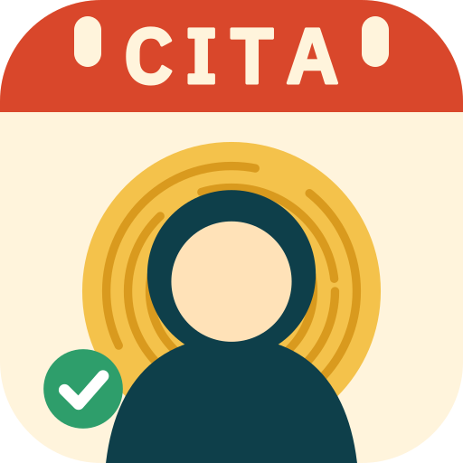
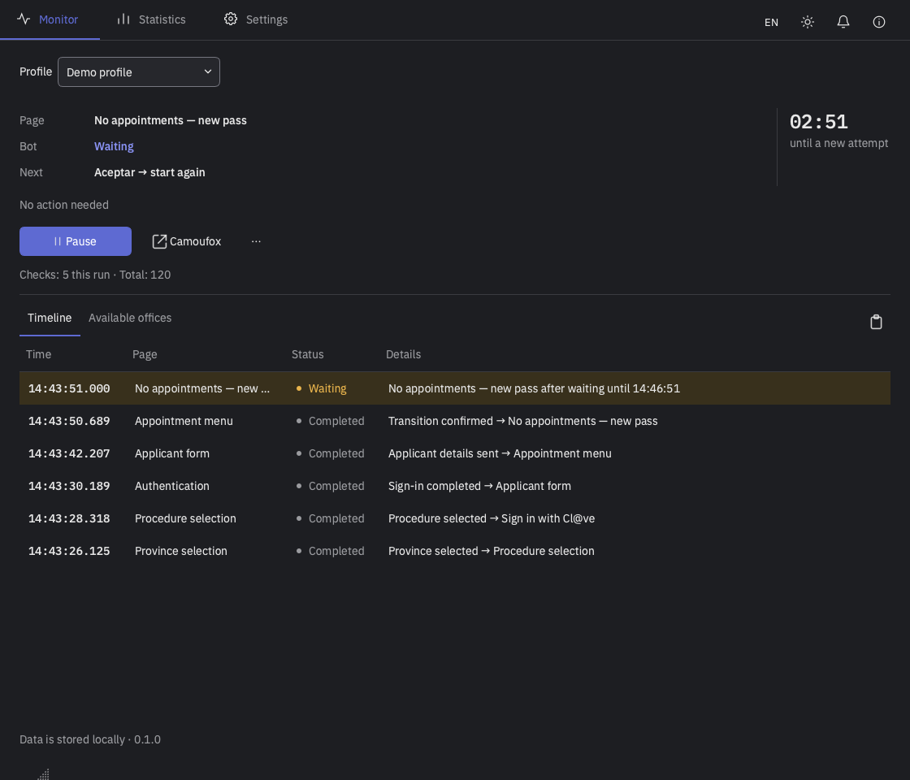
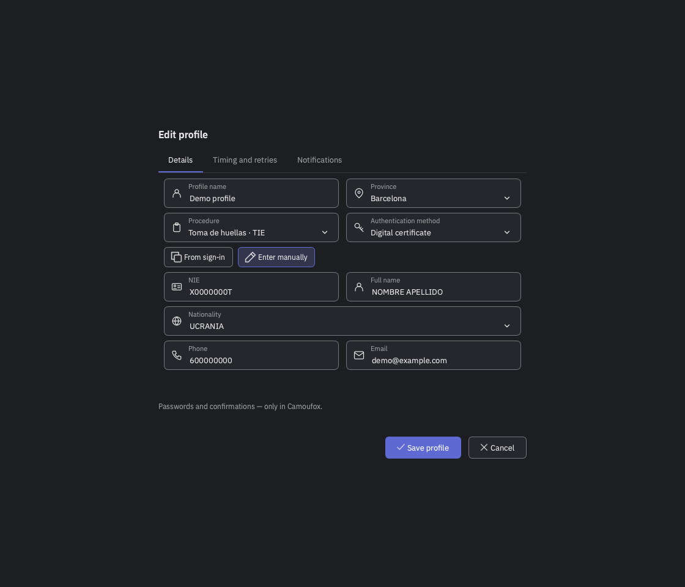
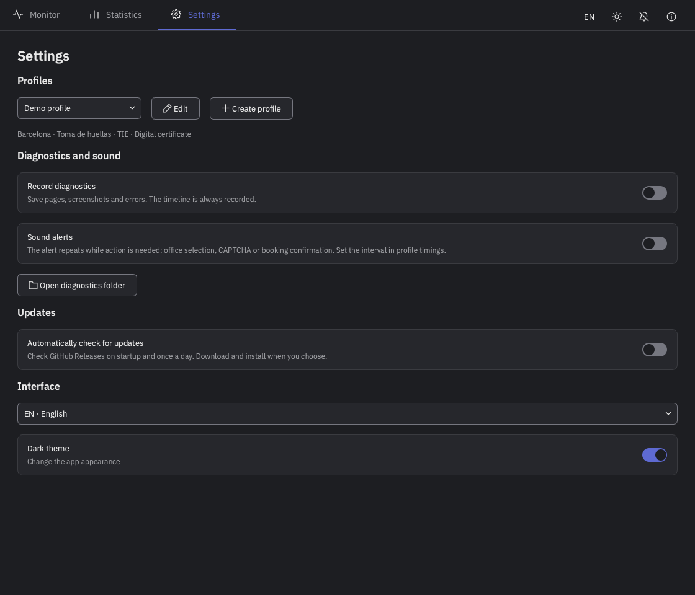
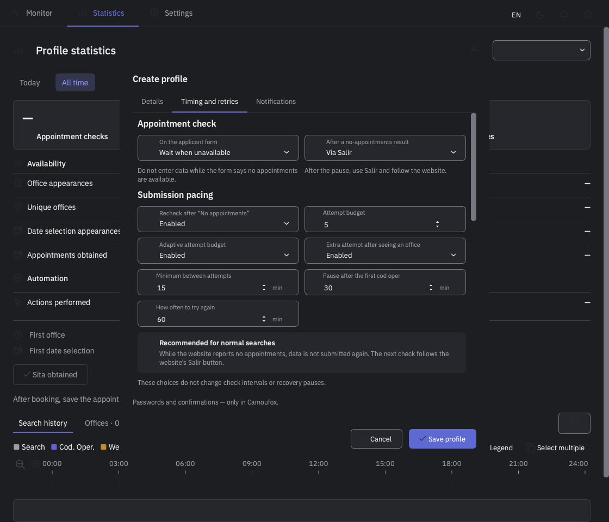
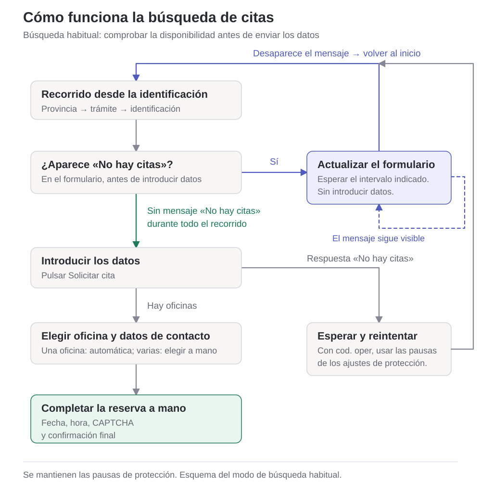

# Extranjería Cita Helper

🇬🇧 [English](README.md) · 🇷🇺 [Русский](README.ru.md) · 🇪🇸 **Español**

[](https://github.com/itwormz/extranjeria-cita-helper/releases/latest)

[Descargar](https://github.com/itwormz/extranjeria-cita-helper/releases/latest) · [Novedades](https://github.com/itwormz/extranjeria-cita-helper/releases/latest) · [Historial completo](CHANGELOG.md)

<h3> ¡Prueba SantaCita, la nueva generación de la aplicación!</h3>

- Más pequeña y rápida.
- Funciona con tu navegador habitual.
- Importa tus perfiles e historial de la versión actual.

[Descargar la beta de SantaCita](https://github.com/itwormz/extranjeria-cita-helper/releases)

**💜 Apoyar el desarrollo**

Si la aplicación te ha ayudado, agradecería una donación para apoyar su desarrollo y mantenimiento.

[](https://github.com/sponsors/itwormz)
[](https://nowpayments.io/donation/itworm)

<a href="docs/images/monitor-dark.png"></a> <a href="docs/images/profile-dark.png"></a> <a href="docs/images/settings-dark.png"></a> <a href="docs/images/timings-dark.png"></a>

Asistente para buscar citas de **Toma de huellas / TIE** y **Autorización de regreso** en ICP Plus.

- Rellena formularios y comprueba la disponibilidad de citas.
- Avisa mediante sonido, Telegram o webhook.
- Guarda el historial de búsqueda y las estadísticas.
- La fecha, el CAPTCHA y la confirmación de la cita se completan manualmente en Camoufox.

La versión estable sigue en Python 0.3.x; SantaCita en Rust está disponible por separado como beta. Python 0.3.8 permite recibir versiones beta de forma opcional. El repositorio todavía no ha cambiado de nombre.

## 🚀 Inicio rápido

1. [Descargue la aplicación](https://github.com/itwormz/extranjeria-cita-helper/releases/latest).
2. En **Ajustes → Crear perfil**, indique la provincia, el trámite, el método de acceso y los datos del solicitante.
3. En **Seguimiento**, seleccione el perfil, pulse **Iniciar** e identifíquese en Camoufox.
4. Deje el navegador abierto. Cuando reciba un aviso, elija oficina o complete la reserva.

| Sistema | Paquete |
| --- | --- |
|  macOS Apple Silicon / Intel | DMG |
|  Windows x64 | MSI o ZIP portátil |
|  Linux x64, glibc ≥ 2.35 | AppImage |

La versión portátil de Windows guarda los datos junto a la aplicación. Al actualizar Linux desde la versión 0.2.3 o anterior, descargue el nuevo AppImage manualmente.

## 🔄 Cómo funciona

<picture>
  <source media="(prefers-color-scheme: dark)" srcset="docs/images/workflow-es-dark.svg">
  <source media="(prefers-color-scheme: light)" srcset="docs/images/workflow-es-light.svg">
  
</picture>

## 🔐 Autenticación

Camoufox viene incluido en la aplicación y se inicia automáticamente. No requiere una instalación aparte.

| Método | Acceso |
| --- | --- |
| Certificado electrónico | Acceso con certificado; menos confirmaciones manuales repetidas |
| Cl@ve Móvil / PIN | Confirmación en la aplicación Cl@ve o código por SMS |
| Cl@ve Permanente | Contraseña permanente, a veces un código por SMS |

[Obtener certificado FNMT](https://www.sede.fnmt.gob.es/certificados/persona-fisica/obtener-certificado-software) · [Registrarse en Cl@ve](https://clave.gob.es/registro/como-puedo-registrarme) · [Cl@ve Permanente](https://clave.gob.es/clave-permanente/procedimientos.html)

Las contraseñas y los PIN se introducen en la web oficial en Camoufox y no se guardan en la aplicación.

Para reservar para otra persona, seleccione **introducir datos del perfil** e indique su documento y nombre. El titular del certificado o de Cl@ve completa la autenticación.

## 🎛️ Controles

- **Pausa / Continuar** — detener o reanudar las acciones automáticas.
- **Continuar búsqueda** tras la selección de fecha — iniciar un nuevo recorrido conservando la sesión del navegador.
- **Reiniciar sesión** — iniciar un nuevo recorrido borrando la sesión del navegador.
- **Confirmar cita** — guardar el resultado después de reservar en la web. Incluye exportación al calendario y una tarjeta de estadísticas para compartir.

Si solo hay una oficina, se selecciona automáticamente; si hay varias, debe elegir. Cerrar la aplicación detiene la búsqueda y cierra Camoufox.

## ⚙️ Ajustes de búsqueda

- Provincia, trámite, método de acceso, datos del solicitante y contactos.
- Intervalos entre acciones, recargas y reintentos tras errores.
- Sonido, idioma, tema claro u oscuro.
- Comprobación de ausencia de citas, presupuesto de intentos y pausas por restricciones.

Los intervalos y los ajustes de protección se aplican desde la siguiente acción. Los demás ajustes del perfil se aplican al iniciar una nueva búsqueda.

### Protección frente a restricciones

- **Volver a comprobar citas** — cuando desaparezca el aviso de que no hay citas, iniciar un nuevo recorrido; enviar los datos solo si no apareció el aviso durante todo el recorrido.
- **Presupuesto de intentos** — referencia diaria, **5** por defecto. No es un límite estricto.
- **Presupuesto adaptativo** — estimación para mañana según los envíos anteriores al primer cod. oper, con un mínimo de **5**.
- **Cambiar para hoy** — fijar un presupuesto manual hasta medianoche. La adaptación sigue recopilando datos para mañana.
- **Distribuir intentos** — espera opcional de ventanas horarias; desactivada por defecto. Una vez agotado el presupuesto, los envíos continúan tras las pausas de protección, sin esperar ventanas.
- **Intentar ahora** — adelantar la próxima oportunidad a ahora e iniciar un nuevo recorrido. Se mantienen los intervalos mínimos y las pausas por HTTP 429.
- **Ralentizar la recarga tras un 429** — añadir 30 segundos al intervalo de recarga del formulario tras cada HTTP 429, hasta el final de la búsqueda actual.

Cod. oper en la página sin citas es un indicio probable de restricción por **NIE o IP**, que puede durar hasta el final del día. La primera pausa predeterminada es de **30 minutos**; las siguientes comprobaciones se realizan cada **60 minutos**.

<details>
<summary>Distribución de intentos durante el día</summary>

Las ventanas de **±30 minutos** cubren lo que queda del día: primero **09:00–18:00**, después hasta medianoche, hora de Madrid. Se recalculan tras un envío o una ventana perdida. El primer intento está disponible a cualquier hora tras las pausas de protección.

Con la distribución activada, un recorrido limpio espera su ventana mientras quede presupuesto. Una vez agotado, solo se mantienen las pausas de protección y los intentos pueden ser más frecuentes.

Intentar ahora permite omitir la ventana o la pausa por cod. oper. Si el aviso aparece en el nuevo recorrido, el permiso se conserva para otro recorrido limpio. Se consume al enviar la solicitud y caduca al final del día.

</details>

## 🔔 Notificaciones

**Ajustes → Editar perfil → Notificaciones.** Eventos: autenticación, selección de oficina, selección de cita y parada con error.

### Telegram

1. Cree un bot con [@BotFather](https://t.me/BotFather), mediante `/newbot`.
2. Active Telegram en el perfil, pegue el token y pulse **Comprobar**.
3. Use **+** junto a los destinatarios para conectar un chat, grupo o canal. El enlace para otro destinatario dura **5 minutos**.
4. Elija los eventos, envíe una prueba y guarde el perfil.

Los mensajes incluyen perfil, provincia, oficinas disponibles y fechas/horas reconocidas de la cita. En macOS, la lectura del token puede requerir la contraseña del Llavero.

### Webhook

Dirección HTTPS, POST o GET y selección de eventos. Opcionalmente, cabeceras, parámetros de URL y plantilla JSON.

Los datos de conexión se guardan en el almacén de credenciales del sistema. Si no está disponible, restablezca el acceso o desactive el canal antes de iniciar la búsqueda. Al cambiar de ordenador, vuelva a introducir los datos de conexión.

## 📊 Estadísticas

- Períodos **Hoy / Todo el tiempo** para cada perfil.
- Comprobaciones de citas, tiempo de búsqueda, oficinas, fechas disponibles, errores y restricciones.
- Cronología, historial de oficinas y registro de acciones entre búsquedas.
- Presupuesto de hoy, intentos restantes y hora del próximo intento.
- Datos reconocidos de la cita y exportación de la reserva confirmada al calendario.

Los datos se guardan localmente. Las estadísticas no se publican automáticamente. Copie las filas del registro con **⌘C / Ctrl+C** o el botón del portapapeles.

## ⬆️ Actualizaciones

**Acerca de → comprobar, descargar e instalar.** Comprobación automática al iniciar y una vez al día; se puede desactivar en ajustes.

Se verifican la autenticidad y la integridad del paquete antes de instalarlo. La búsqueda finaliza; se conservan los perfiles y los ajustes.

Activa **Ofrecer versiones beta** en Ajustes para incluir las versiones beta de SantaCita al buscar actualizaciones. Está desactivado por defecto; las versiones beta pueden contener errores. La descarga e instalación requieren tu confirmación.

**Windows portable:** el actualizador descarga y verifica el ZIP y abre su carpeta. Cierre la aplicación, extraiga la nueva versión en otra carpeta y copie en ella su carpeta `data` anterior. Conserve la carpeta antigua hasta comprobar la actualización.

## ⚠️ Problemas conocidos

- **macOS y aplicaciones a pantalla completa:** mantenga Camoufox y las demás aplicaciones en ventanas normales dentro del mismo Space. De lo contrario, los clics y la escritura pueden quedarse bloqueados.
- **HTTP 429:** espere la pausa; evite reinicios manuales frecuentes. El intervalo predeterminado de reintento es de **3 minutos**.
- **Bloqueo del sitio:** recuperación automática o **Reiniciar sesión**.
- **Autenticación caducada:** puede ser necesario volver a entrar con Cl@ve.
- **Pantalla desconocida:** puede requerir intervención manual.

## 🗂️ Diagnóstico y datos locales

Active el diagnóstico en ajustes para guardar páginas y capturas localmente. Durante la reserva manual no se toman capturas; pueden guardarse HTML, metadatos de navegación y JavaScript del sitio. La carpeta de diagnóstico se abre desde la aplicación.

Si el navegador no arranca, pulse **Copiar informe** y adjúntelo a una [incidencia en GitHub](https://github.com/itwormz/extranjeria-cita-helper/issues). Elimine los datos personales antes de compartir el diagnóstico.

Los datos del documento, contactos, CAPTCHA y números de confirmación no se envían en las notificaciones. [Privacidad](docs/PRIVACY.md).

## 🎯 Finalidad

Proyecto independiente para obtener una cita propia, sin vinculación con las autoridades españolas. No está destinado a revender citas ni a acapararlas masivamente.

Se ofrece tal cual, sin garantía de funcionamiento ni de obtener cita. El usuario es responsable de cumplir la legislación y las reglas del servicio.

## 📣 Un mensaje a las autoridades responsables

El acceso a un trámite administrativo obligatorio no debería depender de la capacidad de una persona para actualizar una página durante semanas, adivinar cuándo aparecen citas o recurrir a intermediarios de pago.

A mi juicio, un sistema que exige este comportamiento a las personas extranjeras menoscaba su dignidad y crea una barrera efectiva de acceso a los servicios públicos. Son necesarios una cola transparente, plazos de espera comprensibles, avisos de disponibilidad y una alternativa accesible a la cita por internet.

Las medidas contra la automatización también pueden dificultar el acceso de los usuarios que utilizan el servicio manualmente. La protección del servicio debe contemplar los falsos positivos y ofrecer un procedimiento claro para recuperar el acceso. Una persona que intenta cumplir un trámite administrativo obligatorio no debería tener que comprender los mecanismos técnicos de protección contra bots.

Este proyecto existe porque el procedimiento habitual para obtener una cita exige un esfuerzo desproporcionado. Espero que las mejoras del servicio oficial hagan innecesarios asistentes como este.

### El mercado paralelo y su coste público

Un procedimiento de cita poco transparente y las dificultades de acceso por los canales habituales crean condiciones favorables para un mercado paralelo en el que el acceso a un servicio público gratuito se convierte en mercancía. El Ministerio del Interior ha informado de investigaciones sobre el acaparamiento masivo de citas mediante automatización para su posterior reventa. Estas prácticas dificultan aún más el acceso de quienes intentan conseguir su propia cita.

Las consecuencias van más allá de las dificultades para las personas extranjeras: combatir el acaparamiento y la reventa requiere investigaciones policiales, análisis técnicos especializados e intervención judicial. A mi juicio, un sistema de asignación accesible y transparente debe abordar las condiciones que favorecen este mercado, junto con la persecución de los abusos.

Las citas de un servicio público deben distribuirse conforme a reglas claras y justas, sin convertirse en una competición de capacidades técnicas o de poder adquisitivo.

Ejemplos oficiales de investigaciones:

- **12 de mayo de 2023:** el Ministerio informó de 69 detenidos y otras 25 personas investigadas como presuntas responsables de pertenencia a organización criminal y daños informáticos. La investigación estaba judicializada en el Juzgado de Instrucción n.º 8 de Valencia; según la Policía, las citas se acaparaban para revenderlas por 30–200 euros. [Comunicado del Ministerio](https://www.interior.gob.es/opencms/es/detalle/articulo/La-Policia-Nacional-desmantela-un-entramado-que-bloqueaba-el-sistema-de-citas-online-de-extranjeria-mediante-un-bot-informatico/).
- **27 de noviembre de 2024:** el Ministerio informó de 21 detenidos en Alicante, Murcia y Valencia en una investigación que incluía venta de citas, bloqueo del sistema mediante bots y falsificación de documentos. [Comunicado del Ministerio](https://www.interior.gob.es/opencms/es/detalle/articulo/La-Policia-Nacional-desarticula-un-grupo-criminal-dedicado-a-la-venta-fraudulenta-de-citas-de-extranjeria-mediante-bots/).

Estos comunicados describen investigaciones y detenciones, no acreditan la existencia de sentencias condenatorias firmes.

### Sus derechos y dónde acudir

- **Base jurídica:** los artículos 12 y 13 de la [Ley 39/2015](https://www.boe.es/eli/es/l/2015/10/01/39) contemplan la asistencia en el uso de medios electrónicos y el derecho a un trato respetuoso que facilite el ejercicio de derechos y el cumplimiento de obligaciones. Estas disposiciones no autorizan la automatización.
- **Errores técnicos y bloqueos:** la [ayuda oficial de cita previa](https://sede.administracionespublicas.gob.es/pagina/index/directorio/ayuda_cita_previa) incluye el teléfono 060 y un formulario de consultas técnicas. Este canal atiende incidencias técnicas.
- **Quejas sobre el acceso a servicios públicos:** acudir al Defensor del Pueblo es gratuito, está al alcance de las personas extranjeras con independencia de su situación legal y no requiere abogado. [Quién puede quejarse y cómo](https://www.defensordelpueblo.es/el-defensor/como-te-podemos-ayudar/) · [Presentar una queja](https://portal-sac.defensordelpueblo.es/es/form/queja). La presentación de una queja no suspende los plazos administrativos.
- **Recomendaciones oficiales:** el Defensor del Pueblo ya ha [reclamado mejoras en el acceso a las citas](https://www.defensordelpueblo.es/resoluciones/dificultades-para-concertar-cita-previa-para-solicitar-asilo/) y su obtención en tiempo y forma.

Si se encuentra con este problema, anote las fechas de sus intentos, los mensajes de error y las consultas al soporte. Describa su propia experiencia con precisión y preséntela por los canales oficiales. Las quejas documentadas ayudan a mostrar la magnitud del problema. No publique números de NIE, DNI o pasaporte, certificados, cookies ni otros datos personales.

## 🧰 Tecnologías utilizadas

| Componente | Versión | Función |
| --- | --- | --- |
| Python | 3.13 | Lógica de la aplicación y automatización |
| PySide6 / Qt | 6.12.0 | Interfaz de escritorio nativa |
| Paquete Python de Camoufox | 0.5.7 | Inicio y configuración del navegador |
| Playwright | 1.62.0 | Control del navegador y análisis de páginas |
| cryptography | 50.0.2 | Verificación de certificados TLS |
| PyYAML | 6.0.3 | Configuración local de perfiles |
| PyInstaller | 6.22.3 | Empaquetado de la aplicación independiente |

Las versiones están fijadas en [uv.lock](uv.lock). La verificación de actualizaciones utiliza Sigstore y SHA256; consulte la [documentación de compilación](docs/BUILD.md#signed-build-provenance).

## 💻 Ejecutar desde el código

Se necesitan [Git](https://git-scm.com/install/), [uv](https://docs.astral.sh/uv/getting-started/installation/), internet y un entorno gráfico. En Windows, utilice WSL con soporte gráfico.

```sh
git clone https://github.com/itwormz/extranjeria-cita-helper.git
cd extranjeria-cita-helper
uv python install 3.13
uv sync --frozen --python 3.13 --extra desktop
uv run python -m camoufox fetch
```

En Linux, instale también las bibliotecas del navegador:

```sh
uv run python -m playwright install-deps firefox
```

Abra la aplicación desde la carpeta del proyecto:

```sh
uv run python -m app.main desktop
```

Para volver a abrir: `uv run python -m app.main desktop` desde la carpeta del proyecto. [Instrucciones de compilación](docs/BUILD.md).

## 💜 Agradecimientos

Gracias por ayudar a difundir el proyecto:

- <a href="https://t.me/bcn_today"> BCN Today</a>
- <a href="https://t.me/spain_pass"> Испанский Паспорт</a>

## 📄 Licencia

[PolyForm Noncommercial 1.0.0](LICENSE). Se permite el uso no comercial, la copia, la modificación y la distribución de la aplicación, conservando los términos de la licencia y el aviso de autoría. No se permite el uso comercial. Esta licencia se aplica al código de este proyecto; los componentes de terceros conservan sus propias licencias.
