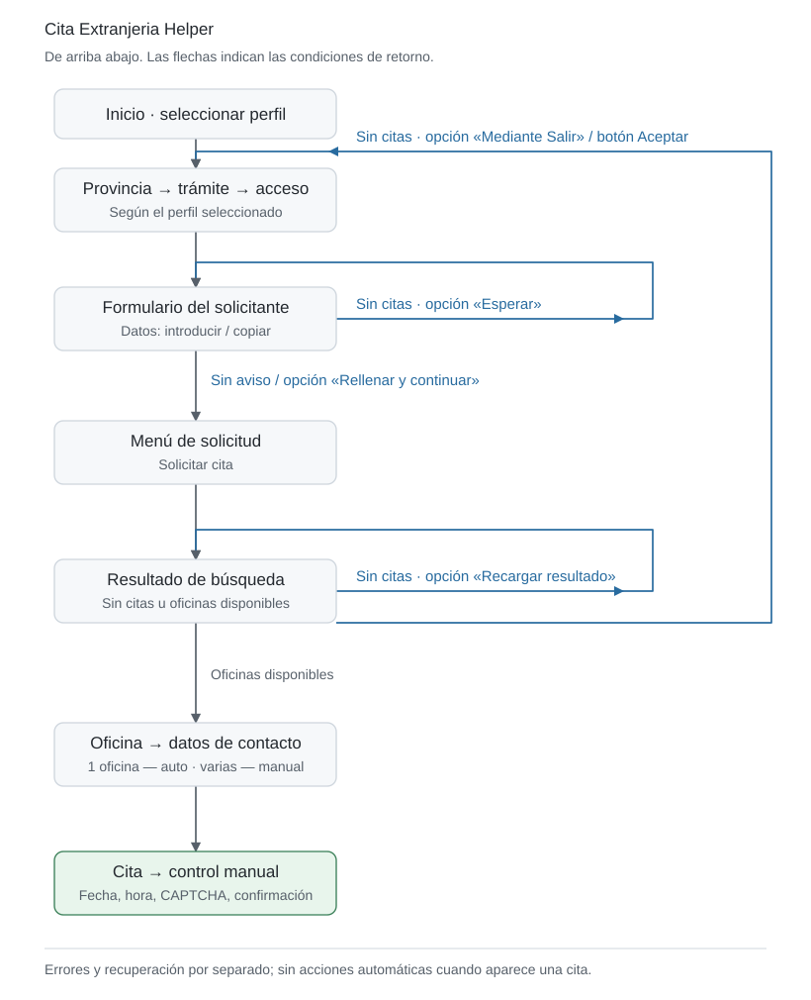

# Extranjería Cita Helper

🇬🇧 [English](README.md) · 🇷🇺 [Русский](README.ru.md) · 🇪🇸 **Español**

[](https://github.com/itwormz/extranjeria-cita-helper/releases/latest)

[Descargar](https://github.com/itwormz/extranjeria-cita-helper/releases/latest) · [Novedades](https://github.com/itwormz/extranjeria-cita-helper/releases/latest) · [Historial completo](CHANGELOG.md)

**💜 Apoyar el desarrollo**

Si la aplicación te ha ayudado, agradecería una donación para apoyar su desarrollo y mantenimiento.

[](https://github.com/sponsors/itwormz)
[](https://nowpayments.io/donation/itworm)

<a href="docs/images/monitor-dark.png"></a> <a href="docs/images/profile-dark.png"></a> <a href="docs/images/settings-dark.png"></a> <a href="docs/images/timings-dark.png"></a>

Asistente de escritorio para buscar citas de Extranjería: **toma de huellas / TIE** y **autorización de regreso**. Rellena formularios en ICP Plus, comprueba la disponibilidad de citas y avisa cuando necesita su intervención.

Solo se admiten estos dos trámites. Otros servicios y opciones de cita no se contemplaron ni se probaron.

## 🚀 Inicio rápido

1. **[Descargue la última versión](https://github.com/itwormz/extranjeria-cita-helper/releases/latest)**. Plataformas compatibles: ** macOS (Apple Silicon e Intel),  Windows x64 y  Linux x64**.
2. Abra **Ajustes → Crear perfil**. Seleccione la provincia, el trámite y el método de autenticación, configure la introducción o copia del documento/nombre e indique teléfono y correo. Guarde el perfil.
3. En **Seguimiento**, seleccione el perfil y pulse **Iniciar**. Complete la autenticación en Camoufox. Consulte los métodos disponibles en [Autenticación](#-autenticación).
4. Deje Camoufox abierto detrás de otras ventanas y active las alertas sonoras. Cuando necesite intervenir, vuelva al navegador. Resuelva el CAPTCHA si aparece, elija la fecha y la hora y confirme personalmente la cita.

Paquetes: **macOS — DMG · Windows — MSI · Linux — AppImage**. El ZIP portátil opcional para Windows guarda los datos junto a la aplicación.

## 🔔 Notificaciones del perfil

En **Ajustes → Editar perfil → Notificaciones**, activar Telegram y/o un webhook. Elegir los eventos por separado para cada canal: autenticación, selección de oficina, selección de cita o búsqueda detenida por un error. La ausencia habitual de citas no genera mensajes.

**Telegram:** crear un bot con [@BotFather](https://t.me/BotFather), pegar el token y pulsar **Comprobar**. El botón **+** junto a los destinatarios permite abrir el bot o copiar un enlace de vinculación de dos minutos para otra persona; confirmar el chat encontrado. Se admiten grupos y Chat ID/canal manual. No se desconecta ningún webhook existente de Telegram. Enviar una prueba y guardar el perfil.

**Webhook:** introducir una URL HTTPS y seleccionar POST (JSON) o GET (parámetros de URL). **Parámetros avanzados** abre las cabeceras, los parámetros de URL y la plantilla JSON personalizada. Los valores son secretos por defecto; el candado cambia este modo de visualización y el ojo muestra temporalmente el valor. Variables: `{{message}}`, `{{event}}`, `{{profile}}`, `{{province}}`, `{{timestamp}}`, `{{event_id}}`. Enviar una prueba antes de guardar.

Las credenciales se guardan en macOS Keychain, Windows Credential Manager o Linux Secret Service (requiere un proveedor de secretos desbloqueado). Las credenciales se leen al abrir la pestaña Notificaciones; editar otros campos del perfil no accede al almacén. No se guardan en texto plano; al trasladar un perfil a otro equipo deben introducirse de nuevo. Los mensajes incluyen el nombre del perfil y la provincia, sin identificadores del solicitante, datos de la cita ni capturas. La reserva remota no está incluida; las acciones manuales siguen realizándose en Camoufox.

## Integridad de las actualizaciones

El workflow con atestaciones compila los paquetes en runners alojados por GitHub y solo publica tras verificar su procedencia firmada con Sigstore. El actualizador verifica el hash, nuestro repositorio y workflow, la etiqueta y el commit; repite la verificación antes de ejecutar el instalador. Si falta la prueba o no es válida, se bloquea la instalación. No requiere GitHub CLI, cuenta ni aprobación manual de cada versión. Los paquetes y etiquetas de una versión inmutable publicada no pueden sustituirse.

Las raíces de confianza se incluyen en la aplicación; no se confía en una caché local compartida de Sigstore. Las versiones antiguas mantienen la comprobación solo por SHA256 hasta actualizarse. La atestación acredita el origen de la compilación, no la seguridad del código fuente.

## 🔄 Cómo funciona

<picture>
  <source media="(prefers-color-scheme: dark)" srcset="docs/images/workflow-es-dark.svg">
  <source media="(prefers-color-scheme: light)" srcset="docs/images/workflow-es-light.svg">
  
</picture>

## 🎯 Finalidad y uso responsable

Cita Extranjeria Helper es un asistente independiente para encontrar una cita de toma de huellas o autorización de regreso a través del servicio oficial. Su única finalidad es reducir las acciones repetitivas y facilitar que cada usuario consiga su propia cita.

El proyecto no está vinculado a las administraciones públicas españolas, no garantiza la obtención de una cita ni está destinado a la reventa o al acaparamiento masivo de citas, al uso de credenciales ajenas, al acceso no autorizado ni a perturbar el funcionamiento del servicio público. El uso de la aplicación debe respetar la legislación vigente y las normas del servicio.

Desarrollé Cita Extranjeria Helper para facilitar que cada usuario obtenga su propia cita a través del servicio oficial. Mi propósito no es infringir la legislación, acceder sin autorización, perturbar los sistemas de información públicos ni restringir el acceso de otros usuarios.

Incorporé intervalos entre acciones y pausas cuando se limita la frecuencia de solicitudes para reducir la carga sobre el servicio. Estas medidas no garantizan la ausencia de consecuencias no deseadas. Si se detecta un comportamiento que perturba el servicio, debe detenerse y corregirse.

Esta declaración de la finalidad del proyecto no constituye una garantía jurídica de que cualquier uso de la aplicación esté permitido.

La aplicación se proporciona «tal cual». No garantizo su funcionamiento ni la obtención de una cita. La utiliza bajo su propia responsabilidad y responde de sus acciones. No me responsabilizo de las consecuencias de su uso.

## 🔐 Autenticación

La aplicación busca citas **con autenticación**. Sin iniciar sesión, el sitio puede mostrar «no hay citas» y sugerir que compruebe la disponibilidad con Cl@ve o un certificado.

Orden recomendado por comodidad:

**1. Certificado electrónico — recomendado**

Permite funcionar durante periodos prolongados sin confirmaciones manuales repetidas. Un certificado vigente también funciona con una TIE caducada. Además, permite registrarse en Cl@ve.

[Obtener un certificado FNMT](https://www.sede.fnmt.gob.es/certificados/persona-fisica/obtener-certificado-software)

**2. Cl@ve Móvil / PIN**

Confirme el acceso en la aplicación Cl@ve o con un PIN recibido por SMS. Cuando caduque la sesión, tendrá que volver a identificarse. Seleccione **Cl@ve Móvil** en el perfil.

[Registrarse en Cl@ve](https://clave.gob.es/registro/como-puedo-registrarme) · [Acceder con la aplicación o SMS](https://clave.gob.es/clave-movil/uso-clave-movil)

**3. Cl@ve Permanente**

Acceso con una contraseña permanente; en ocasiones se requiere también un código por SMS. Cuando caduque la sesión, tendrá que volver a identificarse.

[Activación y gestión de la contraseña](https://clave.gob.es/clave-permanente/procedimientos.html)

**Cita para otra persona.** Quien se autentica y quien acudirá a la cita pueden ser personas distintas. Introduzca los datos del documento y el nombre del destinatario en el perfil y seleccione **Introducir datos del perfil**, en lugar de copiarlos de la página autenticada. El titular del certificado o de Cl@ve realiza personalmente el inicio de sesión.

**Las contraseñas y los PIN se introducen únicamente en el sitio oficial dentro de Camoufox.** La aplicación no los intercepta ni los guarda. La fecha, la hora y la confirmación final de la cita las elige usted.

## 🎛️ Controles y selección de cita

Si solo hay una oficina disponible, el asistente la selecciona y continúa automáticamente. Si hay varias, espera su elección. Después rellena los datos de contacto y deja la selección de fecha y hora en sus manos.

**Pausa / Continuar** pausa y reanuda las acciones automáticas. **Reiniciar sesión**, en el menú de acciones, borra la sesión del navegador y comienza el recorrido de nuevo. Cerrar la ventana de la aplicación finaliza la búsqueda y cierra Camoufox.

Antes de iniciar, **Restablecer sesión** borra la sesión del navegador del perfil seleccionado sin iniciar la búsqueda ni borrar sus datos. El botón de campana de la barra superior activa y desactiva el sonido.

## 📊 Estadísticas y logros del perfil

La pestaña Estadísticas ofrece **Hoy / Todo el tiempo** para cada perfil: comprobaciones, tiempo acumulado de búsqueda activa, oficinas, selección de fecha, errores del servidor, HTTP 429, restricciones de acceso y recorridos repetidos. La línea temporal local distingue páginas observadas, recuperación, control manual y periodos sin observaciones; las oficinas muestran las fechas registradas de aparición. Las horas usan Europe/Madrid. Seleccionar un perfil estadístico no cambia la búsqueda en curso.

Las acciones realizadas y las páginas procesadas reflejan el trabajo automático: cada activación, selección, campo rellenado o recarga completada cuenta como una acción; cada documento reconocido se cuenta una vez. Se excluyen las acciones manuales y los reconocimientos repetidos. Estos contadores empiezan con la actualización y no reconstruyen el trabajo anterior.

En el perfil, en **Tiempos y reintentos**, **Repetir comprobación** usa **Mediante Salir** por defecto; también permite recargar el resultado. El modo Salir espera, pulsa el botón real de la web y sigue las páginas reconocidas; si falta el botón o es ambiguo, solicita revisión. Ambos modos esperan sin introducir datos mientras el formulario indique que no hay citas. No se presupone una reducción de los envíos del documento.

Al iniciar se restaura el último perfil de trabajo; Estadísticas muestra inicialmente ese perfil. Los periodos Cod. Oper. continúan durante la navegación intermedia hasta un resultado normal de disponibilidad. La selección de la cronología cambia solo por una acción explícita y permanece vacía tras actualizar o cambiar el zoom.

Las estadísticas se guardan en SQLite independientemente del diagnóstico y se conservan entre reinicios. Los totales anteriores migran automáticamente manteniendo el original y una copia de seguridad; los contadores sin fecha no se convierten en un historial diario inventado. No se envían estadísticas automáticamente. Una página sin citas con Cod. Oper. se registra como estado observado, no como prueba de bloqueo por documento.
Al pasar por la línea temporal se resalta el tramo o evento; un clic muestra su duración y contadores. Arrastrar selecciona tramos completos; **Seleccionar varios** o ⌘/Ctrl-clic combina la selección. Se excluyen los intervalos no seleccionados y los eventos no se cuentan dos veces. Arrastrar el espacio vacío o usar Alt permite desplazar la vista; se mantienen los gestos del panel táctil.

El historial muestra inicialmente todos los días con observaciones; **Periodo** permite seleccionar fechas. Las fechas y duraciones se conservan por separado: el plazo anterior hasta la primera disponibilidad no es tiempo de búsqueda activa. **≥** indica un mínimo confirmado cuando el historial está incompleto.

Después de confirmar la reserva en la web, marque **Cita conseguida**. Los datos de la cita se guardan localmente; **Añadir al calendario** exporta un evento privado. La tarjeta PNG pública y el texto preparado para redes sociales incluyen solo estadísticas de búsqueda, sin fecha de cita, oficina ni número de confirmación. La publicación y la imagen se adjuntan manualmente. Marcar una cita como conseguida detiene la búsqueda y mantiene Camoufox abierto para consultar o gestionar la reserva. El formulario propone la última oficina conocida del perfil; la oficina, la dirección y el número de confirmación guardados se pueden seleccionar y copiar.

## ⚙️ Ajustes básicos

| Ajuste | Función |
| --- | --- |
| Perfil | Datos del solicitante, contactos, método de acceso y tiempos |
| Provincia | Provincia de la cita |
| Trámite | Toma de huellas / TIE o autorización de regreso |
| Documento y nombre | Introducir los datos o copiarlos tras el acceso. Huellas: NIE y nacionalidad; Regreso: NIE, DNI o pasaporte |
| Tiempos | Intervalos entre acciones, velocidad de escritura, consultas de citas y pausas de recuperación |
| Variación aleatoria | Pausa aleatoria dentro del intervalo configurado; la variación adicional de recuperación está desactivada por defecto |
| Sonido | Alertas repetidas cuando necesita intervenir |
| Diagnóstico | HTML y capturas opcionales; desactivado por defecto. Durante la reserva manual se guarda HTML sin capturas de pantalla |
| Idioma y tema | Inglés, ruso o español; apariencia clara u oscura |

Por defecto, tras un resultado habitual sin citas el asistente espera **30–60 segundos**, pulsa **Salir** y sigue la web; el perfil también permite recargar el resultado. Una página sin citas con **Aceptar** inicia un nuevo recorrido tras una pausa de **3 minutos**. Las acciones se separan **0,3–0,8 segundos** y el sonido se repite cada **3 segundos**. Configure los tiempos dentro del perfil; los cambios se aplican en el siguiente inicio. El idioma inicial sigue el del sistema; si no es compatible, se utiliza inglés.

Seguimiento muestra la página reconocida, la siguiente acción, la cuenta atrás, el número de consultas, el historial de páginas visitadas y las oficinas disponibles. Cada visita muestra su estado, acción y resultado confirmado; pulsar un botón no confirma por sí solo una transición. **Acerca de** permite buscar una nueva versión, descargar un paquete verificado e iniciar la instalación. Puede desactivar en Ajustes la búsqueda automática en GitHub Releases al iniciar y una vez al día. La instalación termina la sesión actual y conserva los perfiles y ajustes.

Las filas seleccionadas del registro se copian con **⌘C / Ctrl+C**, el botón del portapapeles o el menú contextual. Sin selección, el botón del portapapeles copia toda la pestaña actual.

## ⚠️ Problemas conocidos

- **Aplicaciones a pantalla completa en macOS.** Cuando otra aplicación (por ejemplo, Safari) ocupa un Space separado a pantalla completa, las acciones de Camoufox pueden quedarse esperando: los clics y la introducción de texto pueden agotar el tiempo de espera, retrasando la búsqueda o iniciando un nuevo recorrido. Solución provisional: usar la otra aplicación en una ventana normal y mantener Camoufox abierto en el mismo Space; puede permanecer detrás de otras ventanas. La causa exacta aún no está confirmada.
- **Limitación temporal de solicitudes, incluido HTTP 429 — Too Many Requests.** Espere **5–10 minutos** y evite reinicios manuales frecuentes. Con HTTP 429, el asistente conserva la sesión y comprueba el acceso cada **3 minutos** por defecto; ante bloqueos consecutivos, las pausas antes de una sesión nueva son de **30, 60, 120, 300 y 600 segundos**. Se conservan las secuencias personalizadas.
- **Protección contra bots.** Si se reconoce un bloqueo, la sesión debería borrarse automáticamente. Si no ocurre, pulse **Reiniciar sesión** para restablecerla manualmente.
- **Sesiones caducadas y errores del servidor.** El asistente sigue el botón de recuperación reconocido o repite una comprobación segura tras una pausa. Una pantalla desconocida puede requerir intervención manual; con Cl@ve deberá aprobar nuevos accesos periódicamente.

## 🗂️ Diagnóstico y datos locales

Los perfiles, preferencias y sesiones del navegador se guardan localmente. Con el diagnóstico activado, el HTML sigue guardándose durante la reserva manual y su confirmación; los diálogos JavaScript de confirmación no se guardan como páginas HTML independientes. Los archivos JavaScript de ICP ya cargados se guardan una vez por versión de contenido y se vinculan al HTML, sin peticiones adicionales; se excluyen los scripts de autenticación externa. En Ajustes puede activar o desactivar las capturas y abrir la carpeta de diagnóstico. Cada sesión registrada tiene su propia carpeta; el historial de acciones se guarda independientemente de las capturas.

El diagnóstico puede contener datos personales. Elimine la información sensible antes de compartir registros o capturas. Consulte las [notas de privacidad](docs/PRIVACY.md).

Si el navegador no se inicia, pulsar **Copiar informe** en el panel de error y enviar el texto al autor o a GitHub Issues. El informe contiene detalles técnicos del fallo, sin ajustes del perfil ni contenido de las páginas; no se envía nada automáticamente.

## 📣 Un mensaje a las autoridades responsables

El acceso a un trámite administrativo obligatorio no debería depender de la capacidad de una persona para actualizar una página durante semanas, adivinar cuándo aparecen citas o recurrir a intermediarios de pago.

A mi juicio, un sistema que exige este comportamiento a las personas extranjeras menoscaba su dignidad y crea una barrera efectiva de acceso a los servicios públicos. Son necesarios una cola transparente, plazos de espera comprensibles, avisos de disponibilidad y una alternativa accesible a la cita por internet.

Las medidas contra la automatización también pueden dificultar el acceso de los usuarios que utilizan el servicio manualmente. La protección del servicio debe contemplar los falsos positivos y ofrecer un procedimiento claro para recuperar el acceso. Una persona que intenta cumplir un trámite administrativo obligatorio no debería tener que comprender los mecanismos técnicos de protección contra bots.

Este proyecto existe porque el procedimiento habitual para obtener una cita exige un esfuerzo desproporcionado. Espero que las mejoras del servicio oficial hagan innecesarios asistentes como este.

### El mercado paralelo y su coste público

Un procedimiento de cita poco transparente y las dificultades de acceso por los canales habituales crean condiciones favorables para un mercado paralelo en el que el acceso a un servicio público gratuito se convierte en mercancía. El Ministerio del Interior ha informado de investigaciones sobre el acaparamiento masivo de citas mediante automatización para su posterior reventa. Estas prácticas dificultan aún más el acceso de quienes intentan conseguir su propia cita.

Las consecuencias van más allá de las dificultades para las personas extranjeras: combatir el acaparamiento y la reventa requiere investigaciones policiales, análisis técnicos especializados e intervención judicial. A mi juicio, un sistema de asignación accesible y transparente debe abordar las condiciones que favorecen este mercado, junto con la persecución de los abusos.

Las citas de un servicio público deben distribuirse conforme a reglas claras y justas, sin convertirse en una competición de capacidades técnicas o de poder adquisitivo.

Ejemplos oficiales de investigaciones:

- **12 de mayo de 2023:** el Ministerio informó de 69 detenidos y otras 25 personas investigadas como presuntas responsables de pertenencia a organización criminal y daños informáticos. La investigación estaba judicializada en el Juzgado de Instrucción n.º 8 de Valencia; según la Policía, las citas se acaparaban para revenderlas por 30–200 euros. [Comunicado del Ministerio](https://www.interior.gob.es/opencms/es/detalle/articulo/La-Policia-Nacional-desmantela-un-entramado-que-bloqueaba-el-sistema-de-citas-online-de-extranjeria-mediante-un-bot-informatico/).
- **27 de noviembre de 2024:** el Ministerio informó de 21 detenidos en Alicante, Murcia y Valencia en una investigación que incluía venta de citas, bloqueo del sistema mediante bots y falsificación de documentos. [Comunicado del Ministerio](https://www.interior.gob.es/opencms/es/detalle/articulo/La-Policia-Nacional-desarticula-un-grupo-criminal-dedicado-a-la-venta-fraudulenta-de-citas-de-extranjeria-mediante-bots/).

Estos comunicados describen investigaciones y detenciones, no acreditan la existencia de sentencias condenatorias firmes.

### Sus derechos y dónde acudir

- **Base jurídica:** los artículos 12 y 13 de la [Ley 39/2015](https://www.boe.es/eli/es/l/2015/10/01/39) contemplan la asistencia en el uso de medios electrónicos y el derecho a un trato respetuoso que facilite el ejercicio de derechos y el cumplimiento de obligaciones. Estas disposiciones no autorizan la automatización.
- **Errores técnicos y bloqueos:** la [ayuda oficial de cita previa](https://sede.administracionespublicas.gob.es/pagina/index/directorio/ayuda_cita_previa) incluye el teléfono 060 y un formulario de consultas técnicas. Este canal atiende incidencias técnicas.
- **Quejas sobre el acceso a servicios públicos:** acudir al Defensor del Pueblo es gratuito, está al alcance de las personas extranjeras con independencia de su situación legal y no requiere abogado. [Quién puede quejarse y cómo](https://www.defensordelpueblo.es/el-defensor/como-te-podemos-ayudar/) · [Presentar una queja](https://portal-sac.defensordelpueblo.es/es/form/queja). La presentación de una queja no suspende los plazos administrativos.
- **Recomendaciones oficiales:** el Defensor del Pueblo ya ha [reclamado mejoras en el acceso a las citas](https://www.defensordelpueblo.es/resoluciones/dificultades-para-concertar-cita-previa-para-solicitar-asilo/) y su obtención en tiempo y forma.

Si se encuentra con este problema, anote las fechas de sus intentos, los mensajes de error y las consultas al soporte. Describa su propia experiencia con precisión y preséntela por los canales oficiales. Las quejas documentadas ayudan a mostrar la magnitud del problema. No publique números de NIE, DNI o pasaporte, certificados, cookies ni otros datos personales.

## 🧰 Tecnologías utilizadas

Las versiones de las dependencias están fijadas en [`uv.lock`](uv.lock). Los paquetes se generan con Python 3.13; para ejecutar desde el código se necesita Python 3.12 o posterior.

| Componente | Versión | Función |
| --- | --- | --- |
| Python | 3.13 | Lógica de la aplicación y automatización |
| PySide6 / Qt | 6.12.0 | Interfaz de escritorio nativa |
| Paquete Python de Camoufox | 0.5.7 | Inicio y configuración del navegador |
| Playwright | 1.62.0 | Control del navegador y análisis de páginas |
| cryptography | 50.0.2 | Verificación de certificados TLS |
| PyYAML | 6.0.3 | Configuración local de perfiles |
| PyInstaller | 6.22.3 | Empaquetado de la aplicación independiente |

## 💻 Ejecutar desde el código

### 1. Prepare las herramientas

Necesita conexión a internet, un terminal y un entorno gráfico. Instale [Git](https://git-scm.com/install/) siguiendo las instrucciones de su sistema y compruebe:

```sh
git --version
```

Instale [uv](https://docs.astral.sh/uv/getting-started/installation/). En un terminal de macOS/Linux o dentro de WSL:

```sh
curl -LsSf https://astral.sh/uv/install.sh | sh
```

En Windows, ejecute los comandos en el terminal Linux de WSL. Las ventanas de la aplicación y del navegador requieren un entorno gráfico, como [WSLg](https://learn.microsoft.com/en-us/windows/wsl/tutorials/gui-apps).

Cierre y vuelva a abrir el terminal para actualizar PATH y compruebe la instalación:

```sh
uv --version
```

No es necesario instalar Python, pip ni un entorno virtual por separado: uv preparará Python y las dependencias.

### 2. Descargue el proyecto

En el terminal, vaya al directorio donde quiera guardar el proyecto y ejecute:

```sh
git clone https://github.com/itwormz/extranjeria-cita-helper.git
cd extranjeria-cita-helper
```

### 3. Instale Python, dependencias y navegador

Ejecute todos los comandos siguientes desde el directorio del proyecto:

```sh
uv python install 3.13
uv sync --frozen --python 3.13 --extra desktop
uv run python -m camoufox fetch
```

uv crea un entorno local `.venv` e instala las versiones de dependencias fijadas en `uv.lock`. El último comando descarga Camoufox; no necesita instalar Firefox ni Chrome por separado.

Linux también requiere bibliotecas del navegador. En las distribuciones compatibles con Playwright, instálelas con el comando siguiente; puede solicitar permisos de administrador. Consulte la [documentación de dependencias del sistema](https://playwright.dev/python/docs/browsers#install-system-dependencies).

```sh
uv run python -m playwright install-deps firefox
```

### 4. Abra la aplicación

```sh
uv run python -m app.main desktop
```

La primera vez, abra **Ajustes → Crear perfil**. Introduzca los datos y tiempos desde la interfaz; el uso normal no requiere preparar archivos YAML ni variables de entorno. Para identificarse, tenga acceso a Cl@ve o un certificado electrónico disponible en Camoufox mediante el sistema o importado en el navegador.

En los siguientes inicios, abra un terminal en el directorio del proyecto y ejecute el mismo comando. No hace falta activar `.venv` manualmente.

## 📄 Licencia

[PolyForm Noncommercial 1.0.0](LICENSE). Se permite el uso no comercial, la copia, la modificación y la distribución de la aplicación, conservando los términos de la licencia y el aviso de autoría. No se permite el uso comercial. Esta licencia se aplica al código de este proyecto; los componentes de terceros conservan sus propias licencias.
