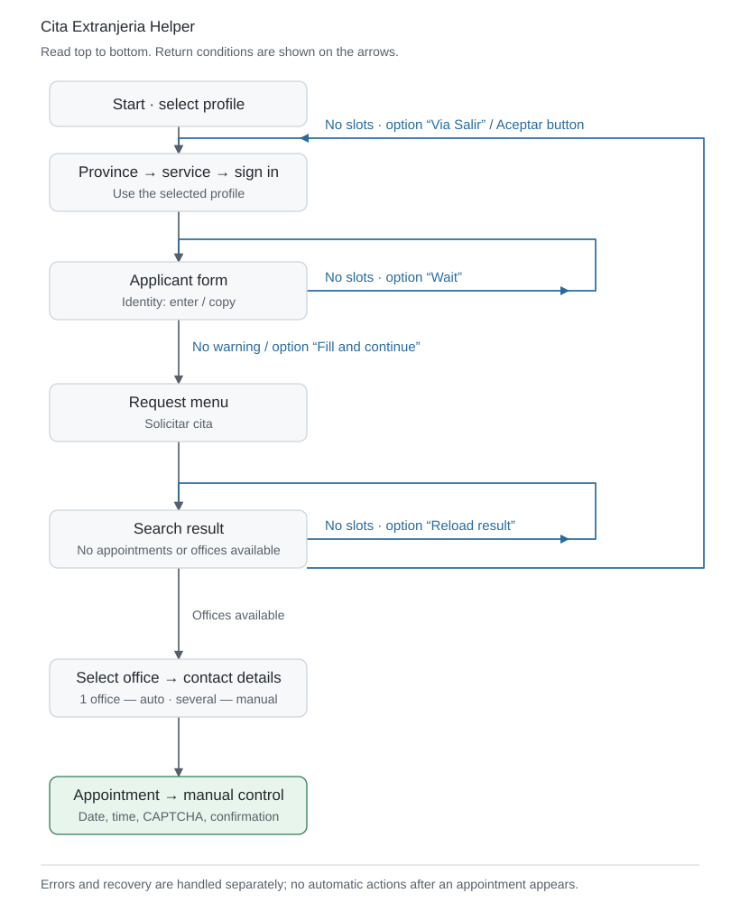

# Extranjería Cita Helper

🇬🇧 **English** · 🇷🇺 [Русский](README.ru.md) · 🇪🇸 [Español](README.es.md)

[](https://github.com/itwormz/extranjeria-cita-helper/releases/latest)

[Download](https://github.com/itwormz/extranjeria-cita-helper/releases/latest) · [What’s new](https://github.com/itwormz/extranjeria-cita-helper/releases/latest) · [Full changelog](CHANGELOG.md)

**💜 Support development**

If the app helped you, I would appreciate a donation to support its development and maintenance.

[](https://github.com/sponsors/itwormz)
[](https://nowpayments.io/donation/itworm)

<a href="docs/images/monitor-dark.png"></a> <a href="docs/images/profile-dark.png"></a> <a href="docs/images/settings-dark.png"></a> <a href="docs/images/timings-dark.png"></a>

A desktop assistant for finding Extranjería appointments: **Toma de huellas / TIE** and **Autorización de regreso**. It fills in forms on ICP Plus, checks appointment availability and alerts you when your attention is needed.

Only these two appointment procedures are supported. Other services and appointment options were neither intended nor tested.

## 🚀 Quick start

1. **[Download the latest release](https://github.com/itwormz/extranjeria-cita-helper/releases/latest)**. Supported platforms: ** macOS (Apple Silicon and Intel),  Windows x64 and  Linux x64**.
2. Open **Settings → Create profile**. Select the province, service and authentication method, configure document/name entry or copying, and enter your phone and email. Save the profile.
3. In **Monitor**, select the profile and click **Start**. Complete authentication in Camoufox. See [Authentication](#-authentication) for the available methods.
4. Leave Camoufox open behind other windows and keep sound alerts enabled. When your participation is needed, switch to the browser. Complete CAPTCHA if shown, choose the appointment date/time and confirm the booking yourself.

Packages: **macOS — DMG · Windows — MSI · Linux — AppImage**. The optional Windows portable ZIP stores data next to the application.

## 🔔 Profile notifications

In **Settings → Edit profile → Notifications**, enable Telegram and/or a webhook and choose events independently for each channel: authentication, office selection, appointment selection or search stopped with an error. Routine “no appointments” results do not send messages.

**Telegram:** create a bot with [@BotFather](https://t.me/BotFather), paste its token and click **Check**. Use **+** next to recipients to open the bot or copy a two-minute pairing link for another recipient; confirm the detected chat. Groups and manual Chat ID/channel entry are supported. An existing Telegram webhook is never disconnected. Finish with **Send test** and save the profile.

**Webhook:** enter an HTTPS URL and select POST (JSON) or GET (URL parameters). **Advanced parameters** opens custom headers, URL parameters and a custom JSON template. Values are secret by default; the lock changes that display mode and the eye temporarily reveals a value. Variables: `{{message}}`, `{{event}}`, `{{profile}}`, `{{province}}`, `{{timestamp}}`, `{{event_id}}`. Send a test before saving.

Notification credentials use macOS Keychain, Windows Credential Manager or Linux Secret Service (an unlocked secret-service provider is required). There is no plaintext fallback; moving a profile to another computer requires entering credentials again. Messages include the profile display name and province, but no applicant identifiers, appointment details or page captures. Remote booking is not included; manual actions remain in Camoufox.

## Update integrity

The attestation-enabled release workflow builds packages on GitHub-hosted runners and publishes only after verifying their signed Sigstore build provenance. The updater checks the package hash, our repository and workflow, release tag and source commit, then verifies again before launching the installer. Missing or invalid proof blocks installation. No GitHub CLI, account or manual release approval is required. Published immutable releases cannot have their packages or tags replaced.

Trust roots ship with the application; verification does not trust a shared local Sigstore cache. Older app versions keep their checksum-only updater until upgraded. Provenance confirms build origin, not the safety of the source code.

## 🔄 How it works

<picture>
  <source media="(prefers-color-scheme: dark)" srcset="docs/images/workflow-en-dark.svg">
  <source media="(prefers-color-scheme: light)" srcset="docs/images/workflow-en-light.svg">
  
</picture>

## 🎯 Purpose and responsible use

Cita Extranjeria Helper is an independent assistant for finding a fingerprinting or Autorización de regreso appointment through the official service. Its sole purpose is to reduce repetitive actions and help users obtain their own appointment.

The project is not affiliated with Spanish public authorities, does not guarantee an appointment and is not intended for reselling or bulk hoarding of appointments, using other people's credentials, unauthorized access or disrupting the public service. Use of the application must comply with applicable law and the service's rules.

I developed Cita Extranjeria Helper to help users obtain their own appointment through the official service. My purpose is not to violate the law, gain unauthorized access, disrupt government information systems or restrict other users' access.

I included intervals between actions and pauses when requests are rate-limited to reduce the load on the service. These measures do not guarantee the absence of unintended consequences. If behaviour that disrupts the service is discovered, it should be stopped and corrected.

This statement of the project's purpose is not a legal guarantee that every use of the application is permitted.

The application is provided “as is”. I do not guarantee that it will work or that you will obtain an appointment. You use it at your own risk and are responsible for your actions. I am not responsible for the consequences of using it.

## 🔐 Authentication

The app searches for appointments **with authentication**. Without signing in, the site may show “no appointments” while suggesting that you check availability using Cl@ve or a certificate.

Recommended order for convenience:

**1. Electronic certificate — recommended**

Allows extended operation without repeated manual confirmations. A valid certificate also works with an expired TIE. It can also be used to register for Cl@ve.

[Obtain an FNMT certificate](https://www.sede.fnmt.gob.es/certificados/persona-fisica/obtener-certificado-software)

**2. Cl@ve Móvil / PIN**

Confirm access in the Cl@ve app or with a PIN sent by SMS. You will need to sign in again when the session expires. Select **Cl@ve Móvil** in your profile.

[Register for Cl@ve](https://clave.gob.es/registro/como-puedo-registrarme) · [Sign in using the app or SMS](https://clave.gob.es/clave-movil/uso-clave-movil)

**3. Cl@ve Permanente**

Sign in with a permanent password; an additional SMS code may be required. You will need to sign in again when the session expires.

[Activate and manage your password](https://clave.gob.es/clave-permanente/procedimientos.html)

**Booking for someone else.** The person authenticating and the appointment recipient can be different people. Enter the recipient’s document details and name in the profile and select **Enter profile details**, rather than copying them from the authenticated page. The authentication holder completes sign-in themselves.

**Passwords and PINs are entered only on the official website in Camoufox.** The application does not intercept or store them. You choose the date and time and complete the final booking confirmation yourself.

## 🎛️ Controls and appointment selection

If exactly one office is available, the assistant selects it and continues automatically. With multiple offices, it waits for your choice. It then fills contact details and leaves date/time selection to you.

**Pause / Resume** pauses and resumes automated actions. **Restart session** in the actions menu clears the browser session and starts the flow again. Before starting, **Reset session** clears the selected profile’s browser session without starting the search or removing profile details. The bell button at the top toggles sound alerts. Closing the application window ends the search and closes Camoufox.

## 📊 Profile statistics and achievements

The Statistics tab keeps **Today / All time** counters separately for each profile, including checks, cumulative active search time, offices, appointment-selection screens, server errors, HTTP 429, access restrictions and repeated passes. A local timeline distinguishes observed pages, recovery, manual control and gaps; the office list shows recorded appearance dates. Times use Europe/Madrid. Selecting a statistics profile does not change the running search.

Hover over the timeline to highlight a segment or event; click for its duration and counters. Drag across complete segments to select a range; **Select multiple** or ⌘/Ctrl-click combines selections. Unselected gaps are excluded and events are not counted twice. Drag empty space or Alt-drag to pan; trackpad gestures remain available.

Actions performed and pages processed measure automated work: one completed activation, selection, field fill or reload counts as one action; a recognized document is counted once. Manual actions and repeated recognition are excluded. These counters start with the updated app and do not reconstruct earlier work.

In profile **Timings and retries**, **Repeat check** selects result reloads (the default) or **Via Salir**. The latter waits and clicks the website’s actual Salir button, then follows recognized pages; an absent or ambiguous button requires review. Both modes wait without entering applicant data while its form reports no appointments. No reduction in document submissions is assumed.

Statistics are stored in SQLite independently of page diagnostics and survive application restarts. Existing totals migrate automatically with an unchanged original and a backup; undated old totals do not become invented daily history. No statistics are uploaded automatically. A no-appointments page with Cod. Oper. is an observed state, not proof of a document-specific ban.

History initially shows all observed days; **Period** selects a date range. Known dates and durations remain separate: the old elapsed time to first availability is not active search time. **≥** marks a confirmed minimum when history is incomplete.

After completing a booking on the website, mark **Appointment obtained**. Appointment details remain local; **Add to calendar** exports a private calendar event. Public PNG cards and prepared social posts contain search statistics only, without the appointment date, office or confirmation number. Posting and attaching the card remain manual. Marking an appointment as obtained stops the search and keeps Camoufox open for viewing or managing the booking. The note suggests the latest known office for the profile; saved office/address and confirmation values can be selected and copied.

## ⚙️ Basic settings

| Setting | Purpose |
| --- | --- |
| Profile | Applicant details, contacts, authentication method and timing settings |
| Province | Choose the province for the appointment |
| Service | Toma de huellas / TIE or Autorización de regreso |
| Document and name | Enter profile values or copy authenticated data. Fingerprinting uses NIE and citizenship; Regreso supports NIE, DNI or passport |
| Timing | Action intervals, typing speed, appointment-check waits and recovery pauses |
| Jitter | Random delay within a configured range; additional recovery jitter is off by default |
| Sound | Repeating alerts when your attention is needed |
| Diagnostics | Optional page HTML and screenshots; off by default. Manual booking keeps HTML capture without screenshots |
| Language and theme | English, Russian or Spanish; light or dark appearance |

By default, a regular no-appointments result is refreshed every **30–60 seconds**. A no-appointments page with **Aceptar** starts a new pass after a **3-minute** pause. Actions are spaced **0.3–0.8 seconds** apart, and alerts repeat every **3 seconds**. Edit timings inside the profile; changes apply on the next start. The initial language follows the system language, falling back to English when unsupported.

Monitor shows the recognized page, next action, countdown, check count, page visit timeline and available-office log. Each visit shows its current status, action and confirmed outcome; sending a button alone does not confirm a transition. **About** lets you check for a new version, download a verified package and start installation. Automatic GitHub Releases checks on startup and once a day can be disabled in Settings. Installation ends the current session and preserves profiles and settings.

Selected log rows can be copied with **⌘C / Ctrl+C**, the clipboard button or the context menu. Without a selection, the clipboard button copies the entire current tab.

## ⚠️ Known issues

- **Full-screen applications on macOS.** When another application (for example, Safari) is full-screen in a separate Space, Camoufox actions may stall: clicks and text entry can time out, delaying progress or restarting the search. Workaround: use the other application in a regular window and keep Camoufox open in the same Space; it may remain behind other windows. The underlying cause has not yet been confirmed.
- **Temporary request-rate limits, including HTTP 429 — Too Many Requests.** Wait **5–10 minutes** and avoid frequent manual restarts. For HTTP 429, the assistant preserves the session and probes access every **3 minutes** by default; a recognized block starts a new session after pauses of **30, 60, 120, 300 and 600 seconds** for consecutive blocks. Custom timing schedules are preserved.
- **Anti-bot protection.** A recognized block should automatically clear the session. If it does not, use **Restart session** to reset it manually.
- **Expired sessions and server errors.** The assistant follows a recognized recovery button or retries a safe check after a pause. An unfamiliar screen may require manual action; Cl@ve users must periodically approve a new sign-in.

## 🗂️ Diagnostics and local data

Profiles, preferences and browser sessions are stored locally. With diagnostics enabled, HTML captures continue through manual booking and confirmation; native JavaScript confirmation dialogs are not saved as separate HTML pages. Settings lets you enable/disable page captures and open the diagnostics folder. Each recorded session has its own directory; the action timeline is recorded independently of page captures.

Diagnostics may contain personal information. Remove sensitive details before sharing logs or screenshots. See [privacy notes](docs/PRIVACY.md).

If the browser fails to start, use **Copy report** in the error panel and send the text to the author or GitHub Issues. The report contains technical failure details, without profile settings or page contents; nothing is sent automatically.

## 📣 A message to the responsible authorities

Access to a mandatory administrative procedure should not depend on a person's ability to refresh a page for weeks, guess when appointments become available or resort to paid intermediaries.

In my view, a system that requires foreign nationals to do this undermines their dignity and creates a practical barrier to public services. A transparent queue, clear waiting times, availability notifications and an accessible alternative to online booking are needed.

Measures against automation can also hinder ordinary users. Service protection should account for false positives and provide a clear process for restoring access. A person trying to complete a mandatory administrative procedure should not have to understand the technical workings of anti-bot protection.

This project exists because the ordinary booking process requires disproportionate effort. I hope improvements to the official service will make assistants like this unnecessary.

### The shadow market and its public cost

An opaque booking process and difficulties with ordinary access create favourable conditions for a shadow market in which access to a free public service becomes a commodity. Spain's Ministry of the Interior has reported investigations into schemes using automation to capture appointments in bulk for resale. Such schemes further hinder people seeking their own appointment.

The consequences extend beyond inconvenience for foreign nationals: combating appointment hoarding and resale requires police investigations, technical expert analysis and judicial involvement. In my view, an accessible and transparent allocation system should address the conditions that enable this market alongside enforcement against abuse.

Public appointments should be allocated according to clear and fair rules, rather than becoming a competition in technical capabilities or applicants' ability to pay.

Official examples of investigations:

- **12 May 2023:** the Ministry reported 69 arrests and a further 25 people under investigation on suspicion of involvement in a criminal organization and computer damage. The investigation involved Investigating Court No. 8 in Valencia; according to police, appointments were captured for resale at €30–200. [Ministry statement](https://www.interior.gob.es/opencms/es/detalle/articulo/La-Policia-Nacional-desmantela-un-entramado-que-bloqueaba-el-sistema-de-citas-online-de-extranjeria-mediante-un-bot-informatico/).
- **27 November 2024:** the Ministry reported 21 arrests in Alicante, Murcia and Valencia in an investigation involving appointment sales, blocking the system with bots and document forgery. [Ministry statement](https://www.interior.gob.es/opencms/es/detalle/articulo/La-Policia-Nacional-desarticula-un-grupo-criminal-dedicado-a-la-venta-fraudulenta-de-citas-de-extranjeria-mediante-bots/).

These are reports of investigations and arrests, not confirmation of final criminal convictions.

### Your rights and where to seek help

- **Legal basis:** Articles 12 and 13 of [Ley 39/2015](https://www.boe.es/eli/es/l/2015/10/01/39) provide for assistance with electronic services and respectful treatment that facilitates exercising rights and fulfilling obligations. These provisions do not authorize automation.
- **Technical errors and blocks:** the [official appointment support page](https://sede.administracionespublicas.gob.es/pagina/index/directorio/ayuda_cita_previa) lists telephone 060 and a technical enquiry form. This channel handles technical issues.
- **Complaints about access to public services:** complaints to the Defensor del Pueblo are free, available to foreign nationals regardless of their legal status and do not require a lawyer. [Who can complain and how](https://www.defensordelpueblo.es/el-defensor/como-te-podemos-ayudar/) · [Submit a complaint](https://portal-sac.defensordelpueblo.es/es/form/queja). Complaints do not suspend administrative deadlines.
- **Official recommendations:** the Defensor del Pueblo has already [called for improved access to appointments](https://www.defensordelpueblo.es/resoluciones/dificultades-para-concertar-cita-previa-para-solicitar-asilo/) and timely booking.

If you face the same problem, record the dates of attempts, error messages and support enquiries. Describe your own experience accurately and submit it through official channels. Documented complaints help show the scale of the problem. Do not publish NIE, DNI or passport numbers, certificates, cookies or other personal data.

## 🧰 Technology stack

Dependency versions are pinned in [`uv.lock`](uv.lock). Packages are built with Python 3.13; running from source requires Python 3.12 or newer.

| Component | Version | Purpose |
| --- | --- | --- |
| Python | 3.13 | Application and automation logic |
| PySide6 / Qt | 6.12.0 | Native desktop interface |
| Camoufox Python package | 0.5.7 | Browser launch and configuration |
| Playwright | 1.62.0 | Browser control and page inspection |
| cryptography | 46.0.7 | TLS certificate verification |
| PyYAML | 6.0.3 | Local profile configuration |
| PyInstaller | 6.22.3 | Standalone application packaging |

## 💻 Run from source

### 1. Prepare the tools

You need an internet connection, a terminal and a graphical desktop. Install [Git](https://git-scm.com/install/) following the instructions for your system, then verify:

```sh
git --version
```

Install [uv](https://docs.astral.sh/uv/getting-started/installation/). In a macOS/Linux terminal or inside WSL:

```sh
curl -LsSf https://astral.sh/uv/install.sh | sh
```

On Windows, run the commands in a WSL Linux terminal. The application and browser windows require a graphical environment such as [WSLg](https://learn.microsoft.com/en-us/windows/wsl/tutorials/gui-apps).

Close and reopen the terminal to refresh PATH, then check the installation:

```sh
uv --version
```

You do not need to install Python, pip or a virtual environment separately: uv will prepare Python and the dependencies.

### 2. Download the project

In your terminal, navigate to the directory where you want to keep the project, then run:

```sh
git clone https://github.com/itwormz/extranjeria-cita-helper.git
cd extranjeria-cita-helper
```

### 3. Install Python, dependencies and the browser

Run all following commands from the project directory:

```sh
uv python install 3.13
uv sync --frozen --python 3.13 --extra desktop
uv run python -m camoufox fetch
```

uv creates a local `.venv` and installs the dependency versions recorded in `uv.lock`. The last command downloads Camoufox; a separate Firefox or Chrome installation is not required.

Linux also needs browser system libraries. On distributions supported by Playwright, install them with the command below; administrator privileges may be requested. See the [system dependency documentation](https://playwright.dev/python/docs/browsers#install-system-dependencies).

```sh
uv run python -m playwright install-deps firefox
```

### 4. Launch the app

```sh
uv run python -m app.main desktop
```

On first launch, open **Settings → Create profile**. Enter all details and timings through the UI; ordinary use does not require preparing a YAML file or environment variables. For authentication, have access to Cl@ve or an electronic certificate available in Camoufox (through OS support or browser import).

For subsequent launches, open a terminal in the project directory and run the same command. You do not need to activate `.venv` manually.

## 📄 License

[PolyForm Noncommercial 1.0.0](LICENSE). Noncommercial use, copying, modification and distribution are permitted, provided the license terms and copyright notice are preserved. Commercial use is not permitted. This license applies to this project’s code; third-party components retain their own licenses.
