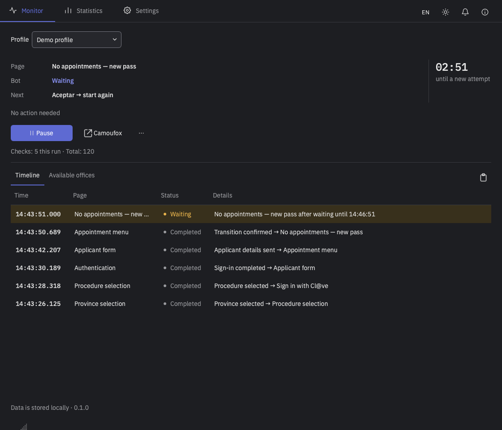
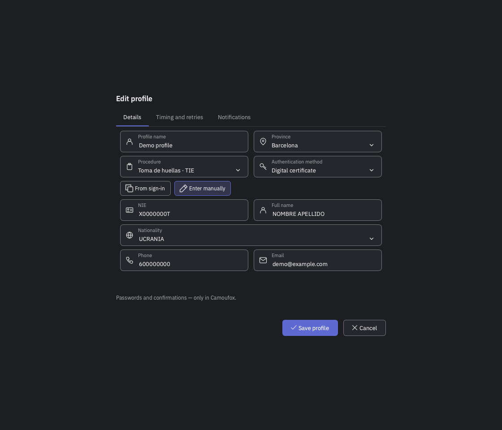
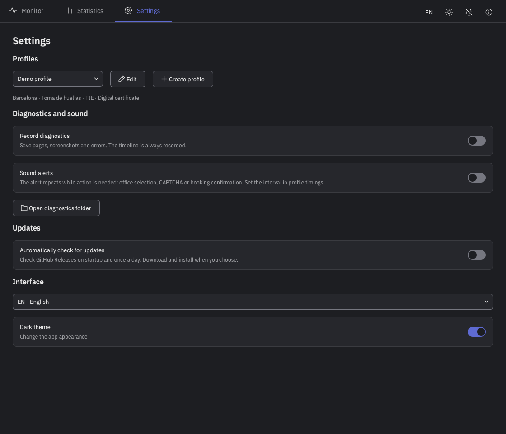
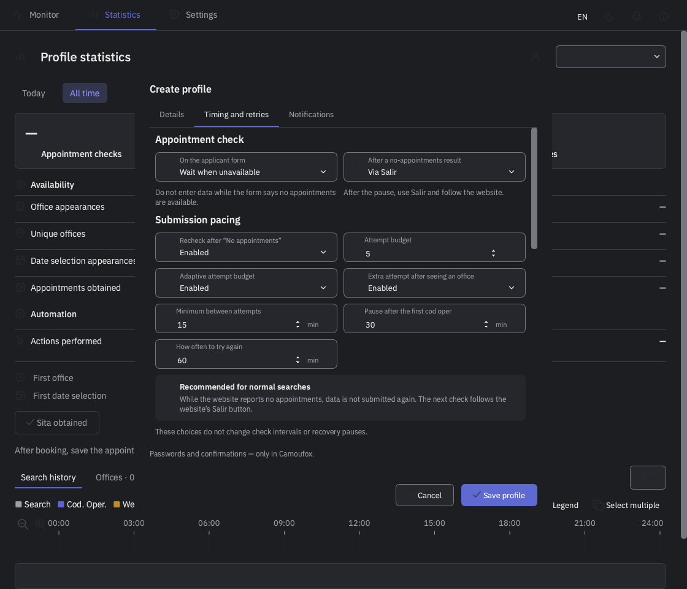
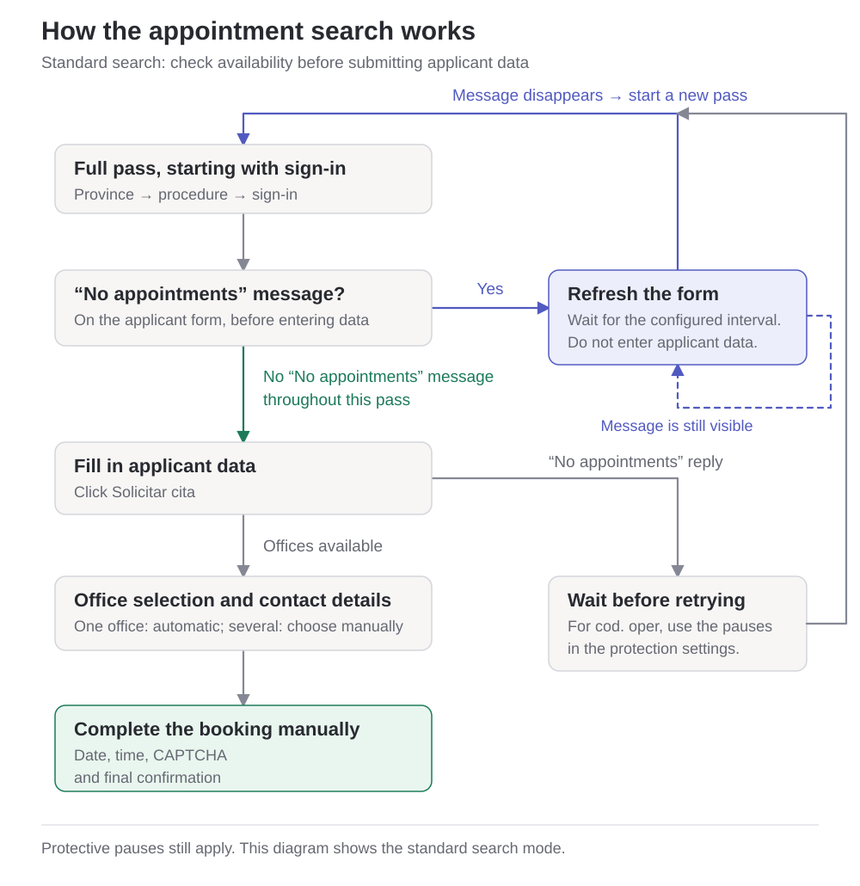

# Extranjería Cita Helper

🇬🇧 **English** · 🇷🇺 [Русский](README.ru.md) · 🇪🇸 [Español](README.es.md)

[](https://github.com/itwormz/extranjeria-cita-helper/releases/latest)

[Download](https://github.com/itwormz/extranjeria-cita-helper/releases/latest) · [What’s new](https://github.com/itwormz/extranjeria-cita-helper/releases/latest) · [Full changelog](CHANGELOG.md)

**💜 Support development**

If the app helped you, I would appreciate a donation to support its development and maintenance.

[](https://github.com/sponsors/itwormz)
[](https://nowpayments.io/donation/itworm)

<a href="docs/images/monitor-dark.png"></a> <a href="docs/images/profile-dark.png"></a> <a href="docs/images/settings-dark.png"></a> <a href="docs/images/timings-dark.png"></a>

An assistant for finding **Toma de huellas / TIE** and **Autorización de regreso** appointments through ICP Plus.

- Fills forms and checks appointment availability.
- Sends sound alerts, Telegram messages or webhooks.
- Keeps search history and statistics.
- Date selection, CAPTCHA and booking confirmation stay manual in Camoufox.

## 🚀 Quick start

1. [Download the app](https://github.com/itwormz/extranjeria-cita-helper/releases/latest).
2. In **Settings → Create profile**, enter the province, service, authentication method and applicant details.
3. In **Monitor**, select the profile, click **Start** and sign in through Camoufox.
4. Leave the browser open. When alerted, choose an office or complete the booking.

| System | Package |
| --- | --- |
|  macOS Apple Silicon / Intel | DMG |
|  Windows x64 | MSI or portable ZIP |
|  Linux x64, glibc ≥ 2.35 | AppImage |

The Windows portable version stores data next to the app. When upgrading Linux from version 0.2.3 or earlier, download the new AppImage manually.

## 🔄 How it works

<picture>
  <source media="(prefers-color-scheme: dark)" srcset="docs/images/workflow-en-dark.svg">
  <source media="(prefers-color-scheme: light)" srcset="docs/images/workflow-en-light.svg">
  
</picture>

## 🔐 Authentication

Camoufox is included with the app and starts automatically. No separate installation is needed.

| Method | Sign-in |
| --- | --- |
| Electronic certificate | Certificate-based sign-in; fewer repeated manual confirmations |
| Cl@ve Móvil / PIN | Confirmation in the Cl@ve app or an SMS code |
| Cl@ve Permanente | Permanent password, sometimes an SMS code |

[Get an FNMT certificate](https://www.sede.fnmt.gob.es/certificados/persona-fisica/obtener-certificado-software) · [Register with Cl@ve](https://clave.gob.es/registro/como-puedo-registrarme) · [Cl@ve Permanente](https://clave.gob.es/clave-permanente/procedimientos.html)

Passwords and PINs are entered on the official website in Camoufox and are not saved by the app.

To book for someone else, select **enter details from the profile** and provide their document and name. The certificate or Cl@ve holder completes authentication.

## 🎛️ Controls

- **Pause / Resume** — stop or resume automatic actions.
- **Continue searching** after date selection — start a new pass while keeping the browser session.
- **Restart session** — start a new pass with a cleared browser session.
- **Confirm booking** — record the result after booking on the website. Calendar export and a shareable statistics card are available.

A single available office is selected automatically; multiple offices require your choice. Closing the app stops the search and closes Camoufox.

## ⚙️ Search settings

- Province, service, authentication method, applicant details and contacts.
- Intervals between actions, page refreshes and retries after errors.
- Sound, interface language, light or dark theme.
- No-appointments checks, attempt budgets and restriction pauses.

Timings and protection settings apply from the next action. Other profile settings apply when starting a new run.

### Protection against restrictions

- **Recheck availability** — when the no-appointments notice disappears, start a new pass; submit details only if no notice appeared during that pass.
- **Attempt budget** — a daily reference, **5** by default. It is not a hard limit.
- **Adaptive budget** — tomorrow’s estimate based on submissions before the first cod. oper, with a minimum of **5**.
- **Change for today** — set a manual budget until midnight. Adaptation keeps collecting data for tomorrow.
- **Schedule attempts** — optional waiting for time windows; off by default. After the budget is exhausted, submissions continue after protective pauses without waiting for windows.
- **Try now** — bring the next opportunity forward to now and start a fresh pass. Minimum intervals and HTTP 429 pauses remain active.
- **Slow refresh after HTTP 429** — add 30 seconds to the form-refresh interval after each HTTP 429, for the rest of the run.

Cod. oper on the no-appointments page likely indicates a restriction on the **NIE or IP** that may last until the end of the day. The default first pause is **30 minutes**, followed by probes every **60 minutes**.

<details>
<summary>Scheduling attempts across the day</summary>

**±30-minute** windows cover the rest of the day: first **09:00–18:00**, then until midnight, Madrid time. They are recalculated after a submission or a missed window. The first attempt is available at any time after protective pauses.

With scheduling enabled, a clean pass waits for its window while budget remains. Once the budget is exhausted, only protective pauses remain, so attempts may become more frequent.

Try now bypasses the window or cod. oper pause. If the notice appears during the new pass, permission remains available for a later clean pass. It is consumed on submission and expires at the end of the day.

</details>

## 🔔 Notifications

**Settings → Edit profile → Notifications.** Events: authentication, office selection, appointment selection and stopping with an error.

### Telegram

1. Create a bot through [@BotFather](https://t.me/BotFather) using `/newbot`.
2. Enable Telegram in the profile, paste the token and click **Check**.
3. Use **+** beside recipients to connect a chat, group or channel. A link for another recipient lasts **5 minutes**.
4. Choose events, send a test and save the profile.

Messages include the profile, province, available offices and recognized appointment dates/times. On macOS, reading the bot token may require the Keychain password.

### Webhook

HTTPS address, POST or GET, and event selection. Optional headers, URL parameters and a JSON template.

Connection details are stored in the system credential store. If it is unavailable, restore access or disable the channel before starting a search. Re-enter connection details after moving to another computer.

## 📊 Statistics

- **Today / All time** periods for each profile.
- Appointment checks, search time, offices, date offers, errors and restrictions.
- Timeline, office history and action log across runs.
- Today’s budget, remaining attempts and next attempt time.
- Recognized appointment details and calendar export of a confirmed booking.

Data stays local. Statistics are not published automatically. Copy log rows with **⌘C / Ctrl+C** or the clipboard button.

## ⬆️ Updates

**About → check, download and install.** Automatic checks run at startup and once a day; disable them in settings.

Package authenticity and integrity are verified before installation. The search ends; profiles and settings are preserved.

## ⚠️ Known issues

- **macOS and full-screen apps:** keep Camoufox and other apps in regular windows in the same Space. Otherwise, clicks and typing may stall.
- **HTTP 429:** wait for the pause; avoid frequent manual restarts. The default retry interval is **3 minutes**.
- **Site blocking:** automatic recovery or **Restart session**.
- **Expired authentication:** signing in again through Cl@ve may be required.
- **Unknown screen:** manual action may be required.

## 🗂️ Diagnostics and local data

Enable diagnostics in settings to save pages and screenshots locally. During manual booking, only HTML is saved. Open the diagnostics folder from the app.

If the browser fails to start, click **Copy report** and attach it to a [GitHub Issue](https://github.com/itwormz/extranjeria-cita-helper/issues). Remove personal data before sharing diagnostics.

Document details, contacts, CAPTCHA and confirmation numbers are not sent through notifications. [Privacy](docs/PRIVACY.md).

## 🎯 Purpose

An independent project for obtaining your own appointment, not affiliated with Spanish authorities. Not intended for appointment resale or mass capture.

Provided as is, without a guarantee of operation or an appointment. Users are responsible for following the law and the service rules.

## 📣 A message to the responsible authorities

Access to a mandatory administrative procedure should not depend on a person's ability to refresh a page for weeks, guess when appointments become available or resort to paid intermediaries.

In my view, a system that requires foreign nationals to do this undermines their dignity and creates a practical barrier to public services. A transparent queue, clear waiting times, availability notifications and an accessible alternative to online booking are needed.

Measures against automation can also hinder ordinary users. Service protection should account for false positives and provide a clear process for restoring access. A person trying to complete a mandatory administrative procedure should not have to understand the technical workings of anti-bot protection.

This project exists because the ordinary booking process requires disproportionate effort. I hope improvements to the official service will make assistants like this unnecessary.

### The shadow market and its public cost

An opaque booking process and difficulties with ordinary access create favourable conditions for a shadow market in which access to a free public service becomes a commodity. Spain's Ministry of the Interior has reported investigations into schemes using automation to capture appointments in bulk for resale. Such schemes further hinder people seeking their own appointment.

The consequences extend beyond inconvenience for foreign nationals: combating appointment hoarding and resale requires police investigations, technical expert analysis and judicial involvement. In my view, an accessible and transparent allocation system should address the conditions that enable this market alongside enforcement against abuse.

Public appointments should be allocated according to clear and fair rules, rather than becoming a competition in technical capabilities or applicants' ability to pay.

Official examples of investigations:

- **12 May 2023:** the Ministry reported 69 arrests and a further 25 people under investigation on suspicion of involvement in a criminal organization and computer damage. The investigation involved Investigating Court No. 8 in Valencia; according to police, appointments were captured for resale at €30–200. [Ministry statement](https://www.interior.gob.es/opencms/es/detalle/articulo/La-Policia-Nacional-desmantela-un-entramado-que-bloqueaba-el-sistema-de-citas-online-de-extranjeria-mediante-un-bot-informatico/).
- **27 November 2024:** the Ministry reported 21 arrests in Alicante, Murcia and Valencia in an investigation involving appointment sales, blocking the system with bots and document forgery. [Ministry statement](https://www.interior.gob.es/opencms/es/detalle/articulo/La-Policia-Nacional-desarticula-un-grupo-criminal-dedicado-a-la-venta-fraudulenta-de-citas-de-extranjeria-mediante-bots/).

These are reports of investigations and arrests, not confirmation of final criminal convictions.

### Your rights and where to seek help

- **Legal basis:** Articles 12 and 13 of [Ley 39/2015](https://www.boe.es/eli/es/l/2015/10/01/39) provide for assistance with electronic services and respectful treatment that facilitates exercising rights and fulfilling obligations. These provisions do not authorize automation.
- **Technical errors and blocks:** the [official appointment support page](https://sede.administracionespublicas.gob.es/pagina/index/directorio/ayuda_cita_previa) lists telephone 060 and a technical enquiry form. This channel handles technical issues.
- **Complaints about access to public services:** complaints to the Defensor del Pueblo are free, available to foreign nationals regardless of their legal status and do not require a lawyer. [Who can complain and how](https://www.defensordelpueblo.es/el-defensor/como-te-podemos-ayudar/) · [Submit a complaint](https://portal-sac.defensordelpueblo.es/es/form/queja). Complaints do not suspend administrative deadlines.
- **Official recommendations:** the Defensor del Pueblo has already [called for improved access to appointments](https://www.defensordelpueblo.es/resoluciones/dificultades-para-concertar-cita-previa-para-solicitar-asilo/) and timely booking.

If you face the same problem, record the dates of attempts, error messages and support enquiries. Describe your own experience accurately and submit it through official channels. Documented complaints help show the scale of the problem. Do not publish NIE, DNI or passport numbers, certificates, cookies or other personal data.

## 🧰 Technology stack

| Component | Version | Purpose |
| --- | --- | --- |
| Python | 3.13 | Application and automation logic |
| PySide6 / Qt | 6.12.0 | Native desktop interface |
| Camoufox Python package | 0.5.7 | Browser launch and configuration |
| Playwright | 1.62.0 | Browser control and page inspection |
| cryptography | 50.0.2 | TLS certificate verification |
| PyYAML | 6.0.3 | Local profile configuration |
| PyInstaller | 6.22.3 | Standalone application packaging |

Versions are pinned in [uv.lock](uv.lock). Update verification uses Sigstore and SHA256; see the [build documentation](docs/BUILD.md#signed-build-provenance).

## 💻 Run from source

Requires [Git](https://git-scm.com/install/), [uv](https://docs.astral.sh/uv/getting-started/installation/), internet access and a graphical environment. On Windows, use WSL with GUI support.

```sh
git clone https://github.com/itwormz/extranjeria-cita-helper.git
cd extranjeria-cita-helper
uv python install 3.13
uv sync --frozen --python 3.13 --extra desktop
uv run python -m camoufox fetch
```

On Linux, also install browser libraries:

```sh
uv run python -m playwright install-deps firefox
```

Launch the app from the project directory:

```sh
uv run python -m app.main desktop
```

To run again: `uv run python -m app.main desktop` from the project directory. [Build instructions](docs/BUILD.md).

## 💜 Acknowledgements

Thank you for helping spread the word about the project:

- <a href="https://t.me/bcn_today"> BCN Today</a>
- <a href="https://t.me/spain_pass"> Испанский Паспорт</a>

## 📄 License

[PolyForm Noncommercial 1.0.0](LICENSE). Noncommercial use, copying, modification and distribution are permitted, provided the license terms and copyright notice are preserved. Commercial use is not permitted. This license applies to this project’s code; third-party components retain their own licenses.
