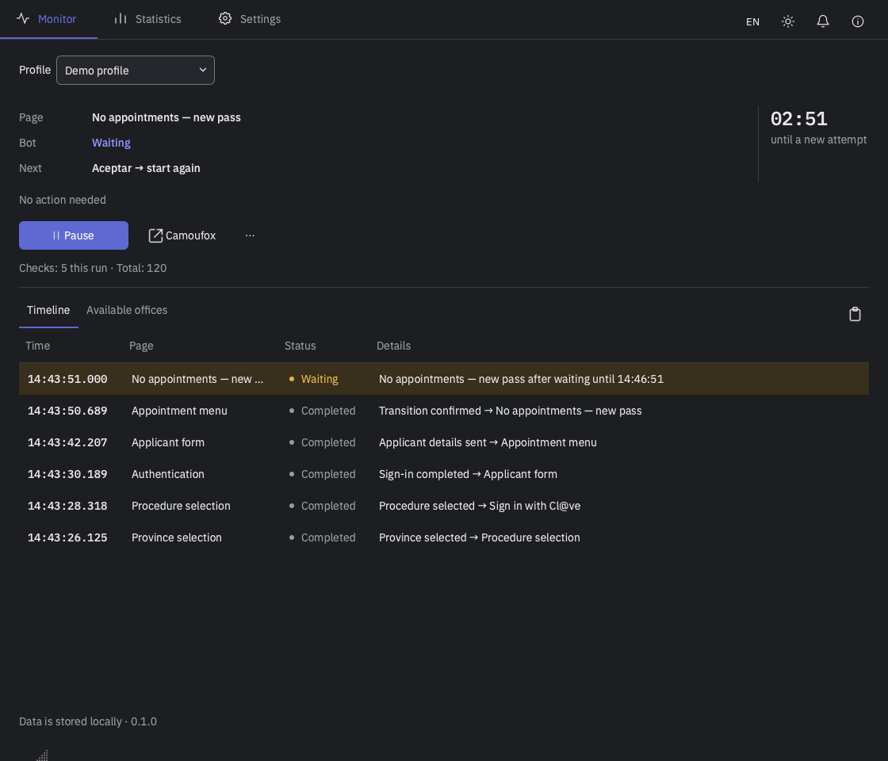
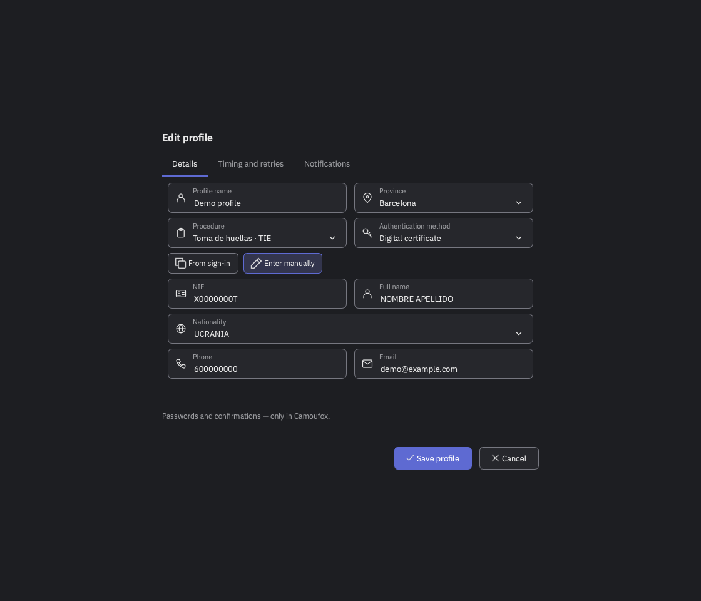
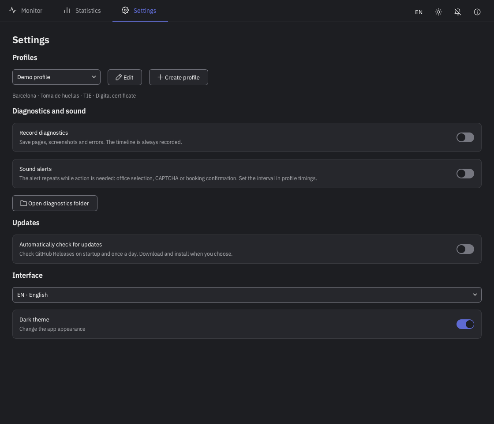
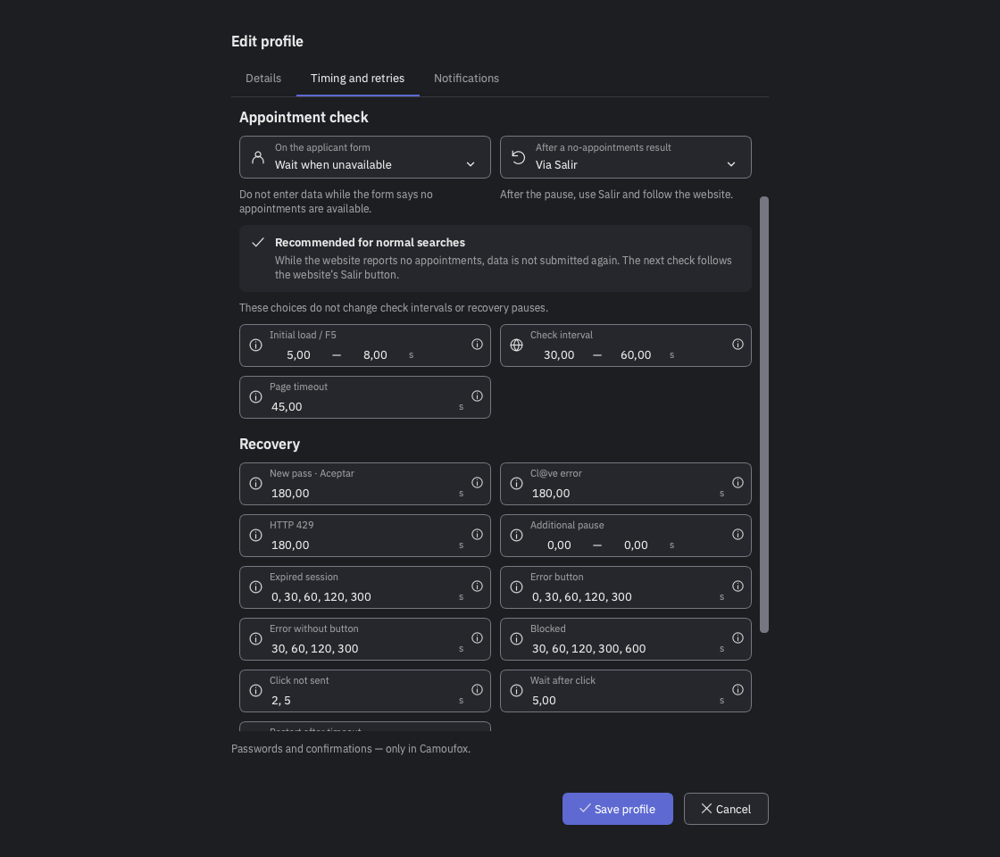
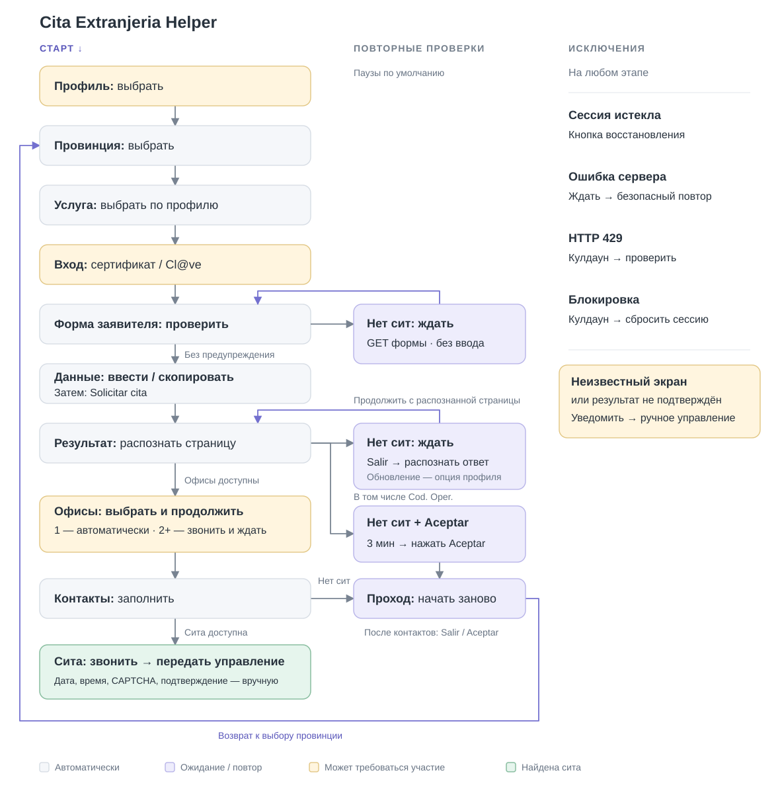

# Extranjería Cita Helper

**Версия: 0.1.1** · [История изменений](CHANGELOG.md)

**💜 Поддержать разработку**

Если приложение помогло вам, буду благодарен за донат на его развитие и поддержку.

[](https://github.com/sponsors/itwormz)
[](https://nowpayments.io/donation/itworm)

[English](README.md) · [Español](README.es.md)

<a href="docs/images/monitor-dark.png"></a> <a href="docs/images/profile-dark.png"></a> <a href="docs/images/settings-dark.png"></a> <a href="docs/images/timings-dark.png"></a>

Настольный помощник для получения ситы в Extranjería на сдачу отпечатков пальцев — **Toma de huellas** для оформления TIE. Заполняет формы на сайте ICP Plus, проверяет наличие сит и сообщает, когда требуется ваше участие.

Приложение предназначено только для этого сценария. Другие услуги и варианты записи не предусматривались и не проверялись.

## 🚀 Быстрый старт

1. **[Скачайте последний релиз](https://github.com/itwormz/extranjeria-cita-helper/releases/latest)**. Поддерживаемые платформы: ** macOS (Apple Silicon и Intel),  Windows x64 и  Linux x64**.
2. Откройте **Настройки → Создать профиль**. Выберите провинцию и способ авторизации, настройте ввод или копирование NIE/имени, укажите телефон и email. Сохраните профиль.
3. Во вкладке **Работа** выберите профиль и нажмите **Запустить**. Пройдите авторизацию в Camoufox. Доступные способы описаны в разделе [Авторизация](#-авторизация).
4. Оставьте Camoufox открытым за другими окнами и включите звуковые уведомления. Когда потребуется ваше участие, переключитесь в браузер. Дату, время и окончательное подтверждение записи выбираете вы.

Пакеты: **macOS — DMG · Windows — MSI · Linux — AppImage**. Дополнительный portable ZIP для Windows хранит данные рядом с приложением.

## 🔄 Как работает приложение

<picture>
  <source media="(prefers-color-scheme: dark)" srcset="docs/images/workflow-ru-dark.svg">
  <source media="(prefers-color-scheme: light)" srcset="docs/images/workflow-ru-light.svg">
  
</picture>

## 🎯 Назначение и ответственное использование

Cita Extranjeria Helper — независимый помощник для поиска записи на сдачу отпечатков пальцев через официальный сервис. Его единственная цель — сократить повторяющиеся действия и облегчить пользователю получение собственной записи.

Проект не связан с государственными органами Испании, не гарантирует получение записи и не предназначен для перепродажи или массового захвата сит, использования чужих учётных данных, несанкционированного доступа либо нарушения работы государственного сервиса. Использование приложения должно соответствовать действующему законодательству и правилам сервиса.

Я разработал Cita Extranjeria Helper, чтобы облегчить пользователю получение собственной записи через официальный сервис. Я не ставлю целью нарушать законодательство, получать несанкционированный доступ, препятствовать работе государственных информационных систем или ограничивать доступ других пользователей.

Я предусмотрел интервалы между действиями и паузы при ограничении частоты запросов, чтобы снизить нагрузку на сервис. Эти меры не гарантируют отсутствие нежелательных последствий. Если обнаружится поведение, нарушающее работу сервиса, его следует прекратить и исправить.

Описание целей проекта не является юридической гарантией допустимости любого использования приложения.

Приложение предоставляется «как есть». Я не гарантирую его работу или получение ситы. Вы используете приложение на свой страх и риск, самостоятельно отвечаете за свои действия. Я не несу ответственности за последствия его использования.

## 🔐 Авторизация

Приложение ищет ситы **с авторизацией**. Без входа сайт может показывать «нет сит», предлагая проверить доступность с Cl@ve или сертификатом.

Рекомендуемый порядок по удобству:

**1. Электронный сертификат — рекомендуется**

Позволяет долго работать без повторных ручных подтверждений. Действующий сертификат работает в том числе при просроченной TIE. С ним также можно зарегистрироваться в Cl@ve.

[Получить сертификат FNMT](https://www.sede.fnmt.gob.es/certificados/persona-fisica/obtener-certificado-software)

**2. Cl@ve Móvil / PIN**

Подтверждение в приложении Cl@ve или PIN по SMS. При истечении сессии потребуется повторный вход. В профиле выбирайте **Cl@ve Móvil**.

[Регистрация в Cl@ve](https://clave.gob.es/registro/como-puedo-registrarme) · [Вход через приложение или SMS](https://clave.gob.es/clave-movil/uso-clave-movil)

**3. Cl@ve Permanente**

Вход с постоянным паролем; иногда дополнительно нужен код по SMS. При истечении сессии потребуется повторный вход.

[Активация и управление паролем](https://clave.gob.es/clave-permanente/procedimientos.html)

**Запись другого человека.** Авторизация и получатель ситы могут быть разными людьми. Укажите в профиле NIE и имя получателя и выберите **ввод данных из профиля**, а не копирование с авторизованной страницы. Владелец авторизации выполняет вход самостоятельно.

**Пароли и PIN вводятся только на официальном сайте в Camoufox.** Приложение их не перехватывает и не сохраняет. Дату, время и окончательное подтверждение записи выбираете вы.

## 🎛️ Управление и выбор ситы


Если доступен один офис, помощник выбирает его и продолжает автоматически. При нескольких офисах он ждёт вашего выбора. Затем заполняет контактные данные и передаёт выбор даты и времени вам.

**Пауза / Продолжить** приостанавливает и возобновляет автоматические действия. **Перезапустить сессию** в меню действий очищает браузерную сессию и начинает проход заново. До запуска **Сбросить сессию** очищает браузерную сессию выбранного профиля, сохраняя его данные и не запуская поиск. Кнопка с колокольчиком сверху включает и выключает звук. Закрытие окна приложения завершает поиск и закрывает Camoufox.

## 📊 Статистика и достижения профиля

Во вкладке «Статистика» отдельно для каждого профиля сохраняются проверки сит, появления офисов, экраны записи, ошибки сервера, ограничения запросов, блокировки и время активного поиска. Выбор профиля для статистики не меняет текущий поиск.

После подтверждения записи на сайте отметьте **«Сита получена»**. Данные записи хранятся локально; **«Добавить в календарь»** экспортирует личное событие. Публичная PNG-карточка и подготовленный пост содержат только статистику поиска — без даты ситы, офиса и номера подтверждения. Публикация и прикрепление картинки выполняются вручную. Отметка полученной ситы останавливает поиск, но оставляет Camoufox открытым для просмотра и управления записью. Форма предлагает последний известный офис профиля; сохранённые офис, адрес и номер подтверждения можно выделить и скопировать.

## ⚙️ Основные настройки

| Настройка | Что делает |
| --- | --- |
| Профиль | Хранит данные заявителя, контакты, способ авторизации и тайминги |
| Провинция | Выбор провинции для записи на сдачу отпечатков |
| NIE и имя | Ввод данных профиля или копирование с сайта после авторизации |
| Тайминги | Интервалы между действиями, скорость ввода, ожидание проверки сит и паузы восстановления |
| Джиттер | Случайная задержка в заданном диапазоне; дополнительный джиттер восстановления по умолчанию выключен |
| Звук | Повторяющийся сигнал при необходимости вашего участия |
| Запись диагностики | Необязательные HTML и снимки страниц; по умолчанию выключена. При ручном оформлении сохраняется HTML без снимков |
| Язык и тема | Английский, русский или испанский; светлая или тёмная тема |

По умолчанию обычный результат «сит нет» обновляется каждые **30–60 секунд**. Страница «сит нет» с **Aceptar** запускает новый проход после паузы **3 минуты**. Задержка между действиями — **0,3–0,8 секунды**, звонок повторяется каждые **3 секунды**. Тайминги настраиваются во вкладке профиля и применяются при следующем запуске. Первый язык выбирается по языку системы; если он не поддерживается, используется английский.

Во вкладке «Работа» видны распознанная страница, следующий шаг, таймер, число проверок, история посещений страниц и журнал доступных офисов. Каждое посещение показывает текущий статус, действие и подтверждённый результат; отправка кнопки сама по себе не подтверждает переход. В **О приложении** можно проверить новую версию, скачать проверенный пакет и запустить установку. Автоматическую проверку GitHub Releases при запуске и раз в сутки можно отключить в настройках. Перед установкой текущая сессия завершается; профили и настройки сохраняются.

Выделенные строки журнала можно скопировать через **⌘C / Ctrl+C**, кнопкой с иконкой буфера или через контекстное меню. Без выделения кнопка буфера копирует текущую вкладку целиком.

## ⚠️ Известные проблемы

- **Полноэкранные приложения на macOS.** Когда другое приложение (например, Safari) открыто на весь экран в отдельном Space, действия в Camoufox могут зависать: клики и ввод завершаются по таймауту, задерживая поиск или вызывая новый проход. Временное решение: использовать другое приложение в обычном окне и держать Camoufox открытым в том же Space — он может оставаться за другими окнами. Точная причина пока не установлена.
- **Временное ограничение частоты запросов, включая HTTP 429 — Too Many Requests.** Подождите **5–10 минут**, избегая частых ручных перезапусков. При HTTP 429 помощник сохраняет сессию и проверяет доступ каждые **3 минуты** по умолчанию; при распознанной блокировке делает паузу перед новой сессией.
- **Защита от ботов.** При распознанной блокировке сессия должна очиститься автоматически. Если этого не произошло, нажмите **Перезапустить сессию** для ручного сброса.
- **Истёкшая сессия и ошибки сервера.** Помощник следует распознанной кнопке восстановления или повторяет безопасную проверку с паузой. Неизвестный экран может потребовать ручного действия; при Cl@ve нужно периодически подтверждать новый вход.

## 🗂️ Диагностика и данные

Профили, настройки и браузерные сессии хранятся локально. При включённой диагностике HTML сохраняется и на этапах ручного оформления и подтверждения; JavaScript-диалоги подтверждения не сохраняются как отдельные HTML-страницы. В настройках можно включить или выключить захваты страниц и открыть папку диагностики. Каждая записанная сессия сохраняется отдельно; таймлайн действий записывается независимо от захватов страниц.

Диагностика может содержать персональные данные. Перед отправкой логов или снимков удалите чувствительную информацию. [Подробнее о приватности](docs/PRIVACY.md).

Если браузер не запускается, в блоке ошибки можно нажать **«Скопировать отчёт»** и отправить текст автору или в GitHub Issues. Отчёт содержит технические сведения об ошибке, без настроек профиля и содержимого страниц; ничего не отправляется автоматически.

## 📣 Обращение к ответственным органам

Доступ к обязательной государственной процедуре не должен зависеть от способности человека неделями обновлять страницу, угадывать момент появления свободных мест или обращаться к платным посредникам.

По моему мнению, система, которая требует от иностранцев такого поведения, унижает их достоинство и создаёт фактический барьер к получению государственных услуг. Необходимы прозрачная очередь, понятные сроки ожидания, уведомления о доступных местах и доступная альтернатива онлайн-записи.

Меры против автоматизации могут создавать препятствия и для обычных пользователей. Защита сервиса должна учитывать ошибочные срабатывания и предоставлять понятный порядок восстановления доступа. Человек, пытающийся выполнить обязательную государственную процедуру, не должен разбираться в технических механизмах антибот-защиты.

Этот проект появился потому, что обычный путь получения записи требует несоразмерных усилий. Я надеюсь, что улучшение официального сервиса сделает подобные помощники ненужными.

### Теневой рынок и общественные издержки

Непрозрачный порядок получения сит и трудности обычного доступа создают благоприятные условия для теневого рынка, где доступ к бесплатной государственной услуге превращается в товар. По сообщениям МВД Испании, расследовались схемы массового захвата записей с помощью автоматизации для последующей перепродажи. Такие схемы дополнительно затрудняют доступ людям, пытающимся получить собственную запись.

Последствия выходят за пределы неудобства для иностранцев: борьба с захватом и перепродажей сит требует полицейских расследований, технических экспертиз и участия судебных органов. По моему мнению, доступная и прозрачная система распределения записей должна устранять условия для такого рынка, одновременно с пресечением злоупотреблений.

Государственная запись должна распределяться по понятным и справедливым правилам, а не превращаться в соревнование технических возможностей или платёжеспособности заявителей.

Официальные примеры расследований:

- **12 мая 2023:** МВД сообщило о 69 задержанных и ещё 25 расследуемых лицах по подозрению в участии в преступной организации и причинении компьютерного ущерба. Расследование велось с участием следственного суда № 8 Валенсии; по версии полиции, записи захватывались для перепродажи за 30–200 евро. [Сообщение МВД](https://www.interior.gob.es/opencms/es/detalle/articulo/La-Policia-Nacional-desmantela-un-entramado-que-bloqueaba-el-sistema-de-citas-online-de-extranjeria-mediante-un-bot-informatico/).
- **27 ноября 2024:** МВД сообщило о 21 задержанном в Аликанте, Мурсии и Валенсии в расследовании, включавшем продажу сит, блокирование системы ботами и подделку документов. [Сообщение МВД](https://www.interior.gob.es/opencms/es/detalle/articulo/La-Policia-Nacional-desarticula-un-grupo-criminal-dedicado-a-la-venta-fraudulenta-de-citas-de-extranjeria-mediante-bots/).

Это сообщения о расследованиях и задержаниях, а не подтверждение вступивших в силу обвинительных приговоров.

### Ваши права и куда обратиться

- **Правовая основа:** статьи 12 и 13 [Ley 39/2015](https://www.boe.es/eli/es/l/2015/10/01/39) предусматривают помощь при использовании электронных средств и право на уважительное обращение, содействующее осуществлению прав и выполнению обязанностей. Эти положения не являются разрешением на автоматизацию.
- **Технические ошибки и блокировки:** [официальная помощь по cita previa](https://sede.administracionespublicas.gob.es/pagina/index/directorio/ayuda_cita_previa) содержит телефон 060 и ссылку на форму технического обращения. Этот канал предназначен для технических проблем.
- **Жалоба на недоступность государственной услуги:** обращение в Defensor del Pueblo бесплатно, доступно иностранцам независимо от их правового положения и не требует адвоката. [Условия обращения](https://www.defensordelpueblo.es/el-defensor/como-te-podemos-ayudar/) · [Подать жалобу](https://portal-sac.defensordelpueblo.es/es/form/queja). Жалоба не приостанавливает административные сроки.
- **Официальные рекомендации:** Defensor del Pueblo уже [требовал улучшить доступ к записи](https://www.defensordelpueblo.es/resoluciones/dificultades-para-concertar-cita-previa-para-solicitar-asilo/) и обеспечить своевременное получение ситы.

Если вы столкнулись с такой же проблемой, фиксируйте даты попыток, сообщения об ошибках и обращения в поддержку. Описывайте собственный опыт точно и направляйте его через официальные каналы. Документированные обращения помогают показать масштаб проблемы. Не публикуйте NIE, сертификаты, cookies и другие личные данные.

## 🧰 Используемый стек

Версии зависимостей закреплены в [`uv.lock`](uv.lock). Приложение собирается с Python 3.13; для запуска из исходников требуется Python 3.12 или новее.

| Компонент | Версия | Назначение |
| --- | --- | --- |
| Python | 3.13 | Логика приложения и автоматизации |
| PySide6 / Qt | 6.12.0 | Настольный интерфейс |
| Python-пакет Camoufox | 0.5.7 | Запуск и настройка браузера |
| Playwright | 1.62.0 | Управление браузером и анализ страниц |
| cryptography | 46.0.7 | Проверка TLS-сертификатов |
| PyYAML | 6.0.3 | Локальные настройки профилей |
| PyInstaller | 6.22.3 | Сборка самостоятельного приложения |

## 💻 Запуск из исходников

### 1. Подготовьте инструменты

Нужны подключение к интернету, терминал и графическое окружение. Установите [Git](https://git-scm.com/install/) по инструкции для вашей системы и проверьте:

```sh
git --version
```

Установите [uv](https://docs.astral.sh/uv/getting-started/installation/). В терминале macOS/Linux или внутри WSL:

```sh
curl -LsSf https://astral.sh/uv/install.sh | sh
```

На Windows выполняйте команды в Linux-терминале WSL. Для окон приложения и браузера требуется графическое окружение, например [WSLg](https://learn.microsoft.com/en-us/windows/wsl/tutorials/gui-apps).

Закройте и снова откройте терминал, чтобы обновился PATH, затем проверьте установку:

```sh
uv --version
```

Отдельно устанавливать Python, pip и виртуальное окружение не нужно: Python и зависимости подготовит uv.

### 2. Скачайте проект

В терминале перейдите в папку, где хотите хранить проект, затем выполните:

```sh
git clone https://github.com/itwormz/extranjeria-cita-helper.git
cd extranjeria-cita-helper
```

### 3. Установите Python, зависимости и браузер

Все следующие команды выполняются из папки проекта:

```sh
uv python install 3.13
uv sync --frozen --python 3.13 --extra desktop
uv run python -m camoufox fetch
```

uv создаст локальное окружение `.venv` и установит версии зависимостей из `uv.lock`. Последняя команда скачивает Camoufox; обычный Firefox или Chrome отдельно устанавливать не требуется.

На Linux нужны системные библиотеки браузера. Для поддерживаемых Playwright дистрибутивов установите их командой ниже; она может запросить права администратора. [Документация системных зависимостей](https://playwright.dev/python/docs/browsers#install-system-dependencies).

```sh
uv run python -m playwright install-deps firefox
```

### 4. Запустите приложение

```sh
uv run python -m app.main desktop
```

При первом запуске откройте **Настройки → Создать профиль**. Все данные и тайминги задаются через интерфейс; готовить YAML-файл или переменные окружения для обычного запуска не нужно. Для входа подготовьте доступ к Cl@ve либо электронный сертификат, доступный Camoufox через систему либо импорт в браузер.

Для последующих запусков достаточно открыть терминал в папке проекта и выполнить ту же команду. Активировать `.venv` вручную не требуется.

## 📄 Лицензия

[PolyForm Noncommercial 1.0.0](LICENSE). Разрешено некоммерческое использование, копирование, изменение и распространение приложения с сохранением условий лицензии и уведомления об авторстве. Коммерческое использование не разрешается. Лицензия распространяется на код этого проекта; сторонние компоненты сохраняют собственные лицензии.
