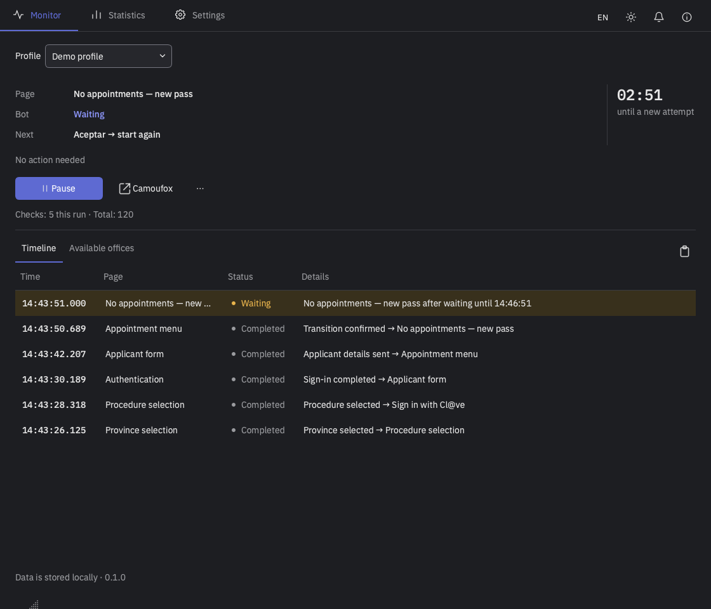
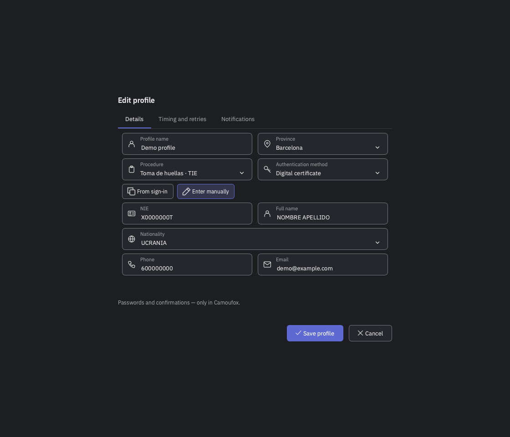
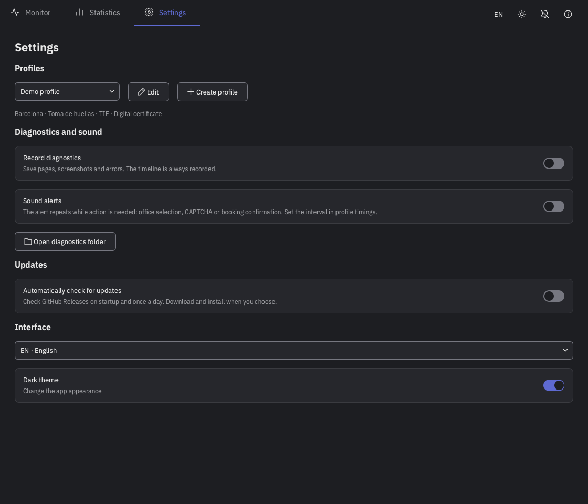
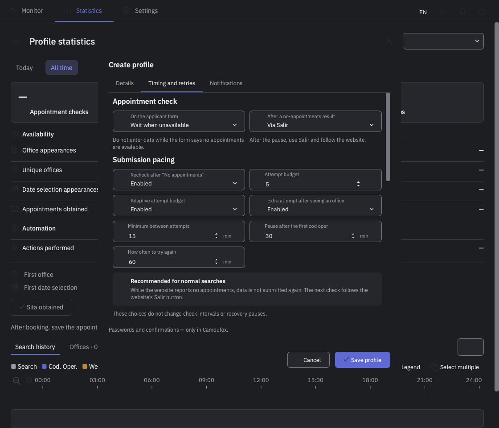
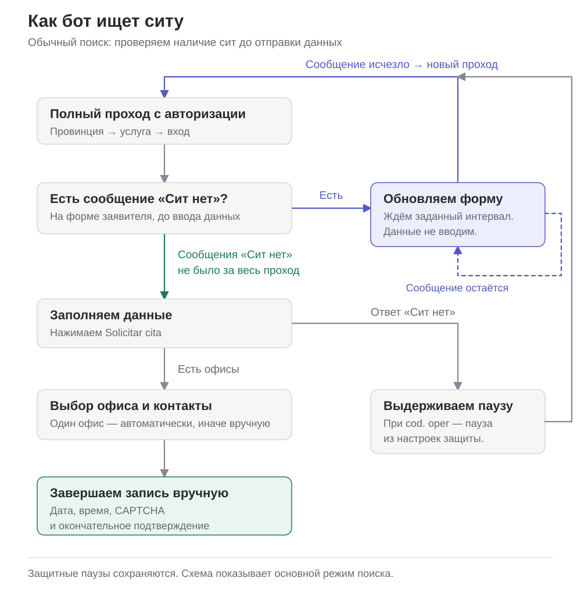

# Extranjería Cita Helper

🇬🇧 [English](README.md) · 🇷🇺 **Русский** · 🇪🇸 [Español](README.es.md)

[](https://github.com/itwormz/extranjeria-cita-helper/releases/latest)

[Скачать](https://github.com/itwormz/extranjeria-cita-helper/releases/latest) · [Что нового](https://github.com/itwormz/extranjeria-cita-helper/releases/latest) · [Полный чейнджлог](CHANGELOG.md)

**💜 Поддержать разработку**

Если приложение помогло вам, буду благодарен за донат на его развитие и поддержку.

[](https://github.com/sponsors/itwormz)
[](https://nowpayments.io/donation/itworm)

<a href="docs/images/monitor-dark.png"></a> <a href="docs/images/profile-dark.png"></a> <a href="docs/images/settings-dark.png"></a> <a href="docs/images/timings-dark.png"></a>

Помощник для поиска сит на **Toma de huellas / TIE** и **Autorización de regreso** через ICP Plus.

- Заполняет формы и проверяет наличие сит.
- Уведомляет звуком, через Telegram или webhook.
- Сохраняет историю поиска и статистику.
- Выбор даты, CAPTCHA и подтверждение записи — вручную в Camoufox.

Проект готовится к переименованию в **SantaCita** и переходу на новую версию на Rust. Python 0.3.8 подготавливает обновлятор к переименованию репозитория и добавляет добровольное получение бета-версий.

## 🚀 Быстрый старт

1. [Скачайте приложение](https://github.com/itwormz/extranjeria-cita-helper/releases/latest).
2. В **Настройки → Создать профиль** укажите провинцию, услугу, способ входа и данные заявителя.
3. Во вкладке **Работа** выберите профиль, нажмите **Запустить** и авторизуйтесь в Camoufox.
4. Оставьте браузер открытым. При уведомлении выберите офис или завершите запись.

| Система | Пакет |
| --- | --- |
|  macOS Apple Silicon / Intel | DMG |
|  Windows x64 | MSI или portable ZIP |
|  Linux x64, glibc ≥ 2.35 | AppImage |

Portable-версия Windows хранит данные рядом с приложением. При обновлении Linux с версии 0.2.3 или старше скачайте новый AppImage вручную.

## 🔄 Как работает приложение

<picture>
  <source media="(prefers-color-scheme: dark)" srcset="docs/images/workflow-ru-dark.svg">
  <source media="(prefers-color-scheme: light)" srcset="docs/images/workflow-ru-light.svg">
  
</picture>

## 🔐 Авторизация

Браузер Camoufox входит в приложение и запускается автоматически. Отдельно устанавливать его не нужно.

| Способ | Вход |
| --- | --- |
| Электронный сертификат | Вход по сертификату; меньше повторных ручных подтверждений |
| Cl@ve Móvil / PIN | Подтверждение в приложении Cl@ve или код из SMS |
| Cl@ve Permanente | Постоянный пароль, иногда код из SMS |

[Получить сертификат FNMT](https://www.sede.fnmt.gob.es/certificados/persona-fisica/obtener-certificado-software) · [Регистрация в Cl@ve](https://clave.gob.es/registro/como-puedo-registrarme) · [Cl@ve Permanente](https://clave.gob.es/clave-permanente/procedimientos.html)

Пароли и PIN вводятся на официальном сайте в Camoufox и не сохраняются приложением.

Для записи другого человека выберите **ввод данных из профиля** и укажите его документ и имя. Авторизацию проходит владелец сертификата или Cl@ve.

## 🎛️ Управление

- **Пауза / Продолжить** — остановить или возобновить автоматические действия.
- **Продолжить поиск** после выбора даты — новый проход с сохранением браузерной сессии.
- **Перезапустить сессию** — новый проход с очисткой браузерной сессии.
- **Подтвердить запись** — сохранить результат после оформления ситы на сайте. Доступны экспорт в календарь и карточка статистики для публикации.

Один доступный офис выбирается автоматически; несколько — вручную. Закрытие приложения завершает поиск и закрывает Camoufox.

## ⚙️ Настройки поиска

- Провинция, услуга, способ авторизации, данные заявителя и контакты.
- Интервалы действий, обновления страниц и повторов после ошибок.
- Звук, язык интерфейса, светлая или тёмная тема.
- Проверка «Сит нет», бюджет попыток и паузы при ограничениях.

Тайминги и настройки защиты применяются со следующего действия. Остальные настройки профиля — при новом запуске.

### Защита от ограничений

- **Перепроверять наличие сит** — после исчезновения плашки «Сит нет» начать новый круг; отправить данные, только если весь круг прошёл без плашки.
- **Бюджет попыток** — дневной ориентир, по умолчанию **5**. Не является жёстким пределом.
- **Адаптивный бюджет** — оценка на завтра по отправкам до первого cod. oper, минимум **5**.
- **Изменить на сегодня** — задать бюджет вручную до полуночи. Адаптация продолжает собирать данные на завтра.
- **Распределять попытки** — необязательное ожидание временных окон; по умолчанию выключено. После исчерпания бюджета отправки продолжаются с защитными паузами, без ожидания окон.
- **Попробовать сейчас** — перенести ближайшую возможность на сейчас и начать свежий проход. Минимальные интервалы и паузы HTTP 429 сохраняются.
- **Замедлять обновление при 429** — прибавлять 30 секунд к интервалу обновления формы после каждого HTTP 429 до конца запуска.

Cod. oper на странице «Сит нет» — вероятный признак ограничения по **NIE или IP**, которое может действовать до конца дня. По умолчанию первая пауза — **30 минут**, следующие пробы — через **60 минут**.

<details>
<summary>Распределение попыток по времени</summary>

Окна **±30 минут** рассчитываются на оставшийся день: сначала **09:00–18:00**, затем до полуночи по Мадриду. Пересчитываются после отправки или пропуска окна. Первая попытка доступна в любое время после защитных пауз.

При включённом распределении чистый проход ждёт окна, пока есть остаток бюджета. После исчерпания бюджета остаются только защитные паузы, поэтому попытки могут стать чаще.

«Попробовать сейчас» отменяет ожидание окна или паузу cod. oper. Если в новом проходе появилась плашка, разрешение сохраняется для следующего чистого прохода. Оно расходуется при отправке и истекает в конце дня.

</details>

## 🔔 Уведомления

**Настройки → Редактировать профиль → Уведомления.** События: авторизация, выбор офиса, выбор ситы, остановка с ошибкой.

### Telegram

1. Создайте бота через [@BotFather](https://t.me/BotFather), команда `/newbot`.
2. Включите Telegram в профиле, вставьте токен и нажмите **Проверить**.
3. Через **+** у получателей подключите чат, группу или канал. Ссылка для другого получателя действует **5 минут**.
4. Выберите события, отправьте тест и сохраните профиль.

В сообщениях — профиль, провинция, доступные офисы и распознанные даты/время ситы. На macOS для чтения токена может потребоваться пароль Связки ключей.

### Webhook

HTTPS-адрес, POST или GET, выбор событий. Дополнительно — заголовки, параметры URL и шаблон JSON.

Данные подключения хранятся в системном хранилище. Если оно недоступно, восстановите доступ или отключите канал перед запуском поиска. После переноса на другой компьютер данные подключения нужно ввести заново.

## 📊 Статистика

- Периоды **Сегодня / За всё время** для каждого профиля.
- Проверки сит, время поиска, офисы, предложения дат, ошибки и ограничения.
- Таймлайн, история офисов и журнал действий между запусками.
- Бюджет на сегодня, остаток и время следующей попытки.
- Данные распознанной ситы и экспорт подтверждённой записи в календарь.

Данные хранятся локально. Статистика автоматически не публикуется. Строки журнала копируются через **⌘C / Ctrl+C** или кнопку буфера.

## ⬆️ Обновления

**О приложении → проверить, скачать и установить.** Автоматическая проверка — при запуске и раз в сутки; отключается в настройках.

Подлинность и целостность пакета проверяются перед установкой. Поиск завершается, профили и настройки сохраняются.

Включите **«Предлагать бета-версии»** в настройках, чтобы получать предложения обновиться до беты SantaCita. По умолчанию выключено; в бета-версиях возможны ошибки. Скачивание и установка — по вашему подтверждению.

**Windows portable:** обновлятор скачивает и проверяет ZIP, затем открывает папку с ним. Закройте приложение, распакуйте новую версию в отдельную папку и перенесите в неё прежнюю папку `data`. Сохраните старую папку приложения до проверки обновления.

## ⚠️ Известные проблемы

- **macOS и полноэкранные приложения:** держите Camoufox и рабочие приложения в одном Space, в обычных окнах. Иначе клики и ввод могут зависать.
- **HTTP 429:** дождитесь паузы; не делайте частые ручные перезапуски. По умолчанию проверка повторяется через **3 минуты**.
- **Блокировка сайта:** автоматическое восстановление или **Перезапустить сессию**.
- **Истёкшая авторизация:** может потребоваться повторный вход через Cl@ve.
- **Неизвестный экран:** может потребоваться ручное действие.

## 🗂️ Диагностика и данные

Диагностика включается в настройках и сохраняет страницы и снимки локально. При ручном оформлении снимки не делаются; могут сохраняться HTML, сведения о переходах и JavaScript сайта. Папка диагностики открывается из приложения.

При ошибке запуска браузера нажмите **Скопировать отчёт** и приложите его к [GitHub Issue](https://github.com/itwormz/extranjeria-cita-helper/issues). Перед отправкой диагностики удалите персональные данные.

Данные документа, контакты, CAPTCHA и номер подтверждения не передаются через уведомления. [Конфиденциальность](docs/PRIVACY.md).

## 🎯 Назначение

Независимый проект для получения собственной записи, не связанный с государственными органами Испании. Не предназначен для перепродажи сит или массового захвата записей.

Приложение предоставляется «как есть», без гарантии работы или получения ситы. Пользователь отвечает за соблюдение законодательства и правил сервиса.

## 📣 Обращение к ответственным органам

Доступ к обязательной государственной процедуре не должен зависеть от способности человека неделями обновлять страницу, угадывать момент появления свободных мест или обращаться к платным посредникам.

По моему мнению, система, которая требует от иностранцев такого поведения, унижает их достоинство и создаёт фактический барьер к получению государственных услуг. Необходимы прозрачная очередь, понятные сроки ожидания, уведомления о доступных местах и доступная альтернатива онлайн-записи.

Меры против автоматизации могут создавать препятствия и для обычных пользователей. Защита сервиса должна учитывать ошибочные срабатывания и предоставлять понятный порядок восстановления доступа. Человек, пытающийся выполнить обязательную государственную процедуру, не должен разбираться в технических механизмах антибот-защиты.

Этот проект появился потому, что обычный путь получения записи требует несоразмерных усилий. Я надеюсь, что улучшение официального сервиса сделает подобные помощники ненужными.

### Теневой рынок и общественные издержки

Непрозрачный порядок получения сит и трудности обычного доступа создают благоприятные условия для теневого рынка, где доступ к бесплатной государственной услуге превращается в товар. По сообщениям МВД Испании, расследовались схемы массового захвата записей с помощью автоматизации для последующей перепродажи. Такие схемы дополнительно затрудняют доступ людям, пытающимся получить собственную запись.

Последствия выходят за пределы неудобства для иностранцев: борьба с захватом и перепродажей сит требует полицейских расследований, технических экспертиз и участия судебных органов. По моему мнению, доступная и прозрачная система распределения записей должна устранять условия для такого рынка, одновременно с пресечением злоупотреблений.

Государственная запись должна распределяться по понятным и справедливым правилам, а не превращаться в соревнование технических возможностей или платёжеспособности заявителей.

Официальные примеры расследований:

- **12 мая 2023:** МВД сообщило о 69 задержанных и ещё 25 расследуемых лицах по подозрению в участии в преступной организации и причинении компьютерного ущерба. Расследование велось с участием следственного суда № 8 Валенсии; по версии полиции, записи захватывались для перепродажи за 30–200 евро. [Сообщение МВД](https://www.interior.gob.es/opencms/es/detalle/articulo/La-Policia-Nacional-desmantela-un-entramado-que-bloqueaba-el-sistema-de-citas-online-de-extranjeria-mediante-un-bot-informatico/).
- **27 ноября 2024:** МВД сообщило о 21 задержанном в Аликанте, Мурсии и Валенсии в расследовании, включавшем продажу сит, блокирование системы ботами и подделку документов. [Сообщение МВД](https://www.interior.gob.es/opencms/es/detalle/articulo/La-Policia-Nacional-desarticula-un-grupo-criminal-dedicado-a-la-venta-fraudulenta-de-citas-de-extranjeria-mediante-bots/).

Это сообщения о расследованиях и задержаниях, а не подтверждение вступивших в силу обвинительных приговоров.

### Ваши права и куда обратиться

- **Правовая основа:** статьи 12 и 13 [Ley 39/2015](https://www.boe.es/eli/es/l/2015/10/01/39) предусматривают помощь при использовании электронных средств и право на уважительное обращение, содействующее осуществлению прав и выполнению обязанностей. Эти положения не являются разрешением на автоматизацию.
- **Технические ошибки и блокировки:** [официальная помощь по cita previa](https://sede.administracionespublicas.gob.es/pagina/index/directorio/ayuda_cita_previa) содержит телефон 060 и ссылку на форму технического обращения. Этот канал предназначен для технических проблем.
- **Жалоба на недоступность государственной услуги:** обращение в Defensor del Pueblo бесплатно, доступно иностранцам независимо от их правового положения и не требует адвоката. [Условия обращения](https://www.defensordelpueblo.es/el-defensor/como-te-podemos-ayudar/) · [Подать жалобу](https://portal-sac.defensordelpueblo.es/es/form/queja). Жалоба не приостанавливает административные сроки.
- **Официальные рекомендации:** Defensor del Pueblo уже [требовал улучшить доступ к записи](https://www.defensordelpueblo.es/resoluciones/dificultades-para-concertar-cita-previa-para-solicitar-asilo/) и обеспечить своевременное получение ситы.

Если вы столкнулись с такой же проблемой, фиксируйте даты попыток, сообщения об ошибках и обращения в поддержку. Описывайте собственный опыт точно и направляйте его через официальные каналы. Документированные обращения помогают показать масштаб проблемы. Не публикуйте номера NIE, DNI или паспорта, сертификаты, cookies и другие личные данные.

## 🧰 Используемый стек

| Компонент | Версия | Назначение |
| --- | --- | --- |
| Python | 3.13 | Логика приложения и автоматизации |
| PySide6 / Qt | 6.12.0 | Настольный интерфейс |
| Python-пакет Camoufox | 0.5.7 | Запуск и настройка браузера |
| Playwright | 1.62.0 | Управление браузером и анализ страниц |
| cryptography | 50.0.2 | Проверка TLS-сертификатов |
| PyYAML | 6.0.3 | Локальные настройки профилей |
| PyInstaller | 6.22.3 | Сборка самостоятельного приложения |

Версии закреплены в [uv.lock](uv.lock). Проверка обновлений — Sigstore и SHA256; подробности — в [документации сборки](docs/BUILD.md#signed-build-provenance).

## 💻 Запуск из исходников

Нужны [Git](https://git-scm.com/install/), [uv](https://docs.astral.sh/uv/getting-started/installation/), интернет и графическое окружение. На Windows — WSL с поддержкой графических приложений.

```sh
git clone https://github.com/itwormz/extranjeria-cita-helper.git
cd extranjeria-cita-helper
uv python install 3.13
uv sync --frozen --python 3.13 --extra desktop
uv run python -m camoufox fetch
```

На Linux дополнительно установите библиотеки браузера:

```sh
uv run python -m playwright install-deps firefox
```

Запустите приложение из папки проекта:

```sh
uv run python -m app.main desktop
```

Повторный запуск: `uv run python -m app.main desktop` из папки проекта. [Сборка приложения](docs/BUILD.md).

## 💜 Благодарности

Благодарим за информационную поддержку:

- <a href="https://t.me/bcn_today"> BCN Today</a>
- <a href="https://t.me/spain_pass"> Испанский Паспорт</a>

## 📄 Лицензия

[PolyForm Noncommercial 1.0.0](LICENSE). Разрешено некоммерческое использование, копирование, изменение и распространение приложения с сохранением условий лицензии и уведомления об авторстве. Коммерческое использование не разрешается. Лицензия распространяется на код этого проекта; сторонние компоненты сохраняют собственные лицензии.
